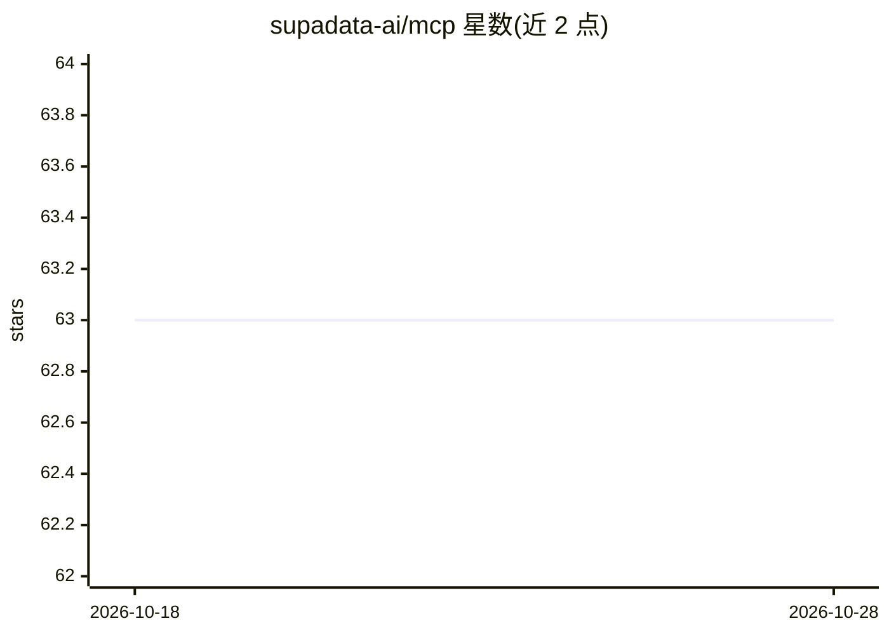

# supadata-ai/mcp

⭐ 63 · TypeScript · MIT · 推送 2026-10-27 · [GitHub](https://github.com/supadata-ai/mcp) · [官网](https://supadata.ai) · 组织维护

**为 MCP 客户端接入 Supadata 视频转录与网页抓取的服务**

Supadata 官方维护的 Model Context Protocol（MCP）服务器，把 Supadata API 的能力以工具形式暴露给 Claude Desktop、Cursor、VS Code、Windsurf 等 MCP 客户端：从 YouTube、TikTok、Instagram、Twitter 及文件 URL 提取视频转录文本，网页抓取、站点 URL 发现与多页爬取，媒体元数据获取，以及基于 AI 的视频结构化数据抽取。支持 stdio 本地运行（需 SUPADATA_API_KEY）与部署在 Cloudflare Worker 上的 Streamable HTTP 托管模式（OAuth 2.1，连接 30 天不用即过期）。

## 筛选速览

| 维度 | 判定 | 备注 |
|---|---|---|
| AI 角色 | `ai-ecosystem` | LLM/agent 周边工具 |
| 许可风险 | `permissive` | MIT |
| 部署形态 | `library` | 以包/库形式分发 |
| 模型依赖 | — | README 未给出锁定关系 |
| 硬件要求 | — | 无带数字的原话,不猜 |
| 安装摩擦 | `low` | 无编译、无系统依赖或容器化 |
| 成熟度 | — | 结构信号不足 |

## 能力要点

- YouTube/TikTok/Instagram/Twitter 及文件 URL 的视频转录提取
- 网页抓取、站点 URL 发现与多页异步爬取
- 基于 AI 的视频结构化数据抽取（提供 prompt 与 JSON Schema）
- stdio 与 Streamable HTTP 两种运行方式

## 适用场景

- 在 Cursor/Claude 等 MCP 客户端中直接获取视频字幕与元数据
- 让 LLM 客户端抓取、爬取网页内容用于回答
- 从视频内容中按自定义 Schema 抽取结构化数据

## 场景标签

`网页抓取` · 领域:效率与自动化

## 证据(README 行号)

> L5: A Model Context Protocol (MCP) server that integrates with Supadata for video transcript extraction, web scraping, c
> L22: Running the package starts an MCP server on stdio. This is what MCP clients
> L23: (Claude Desktop, Cursor, VS Code, Windsurf, ...) use when they spawn the server:

## 星数曲线

2026-10-18 63 → 2026-10-28 63（+0）

---
*卡片 v1 · prompt 1.4 · 生成 2026-10-24 · 置信度 high · 依据 README sha `b9bd98478cb5` · [字段定义](../../DATASET.md)*
