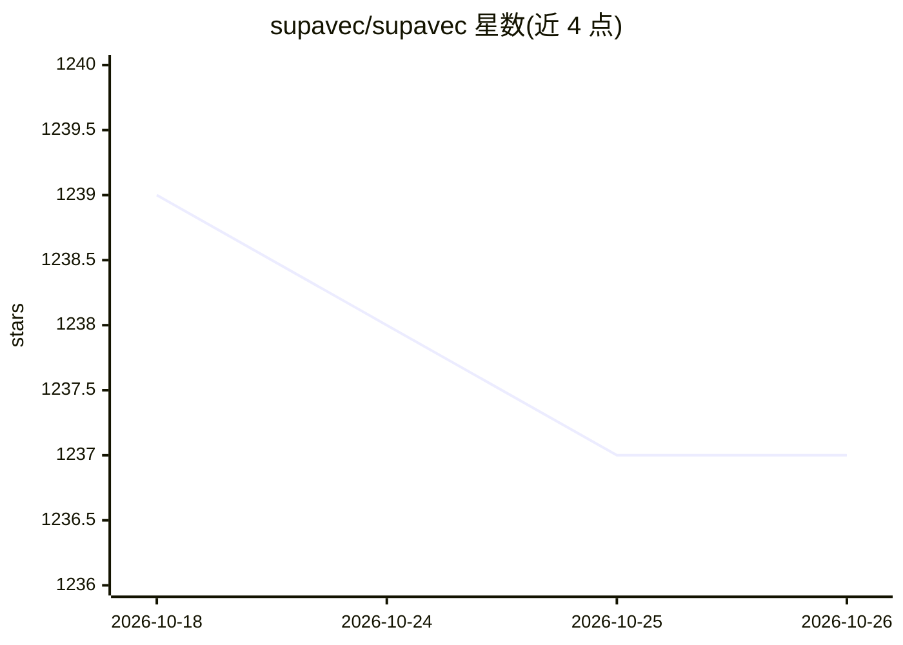

# supavec/supavec

⭐ 1,237 · TypeScript · Apache-2.0 · 推送 2025-12-28 · [GitHub](https://github.com/supavec/supavec) · [官网](https://www.supavec.com) · 个人维护

**开源 RAG 即服务平台：向量搜索与聊天 API，自称 Carbon.ai 替代**

基于 Next.js、Supabase、Tailwind CSS、Bun、Upstash 构建的 OSS RAG-as-a-Service 项目，提供向量搜索与聊天 API，自称 Carbon.ai 的开源替代。面向构建 RAG 应用的开发者，机制包括基于 Supabase 的多租户 Row-Level Security 隔离、可配置分块与重叠的批量嵌入、混合过滤向量检索、Redis 滑动窗口限流、PostHog 实时分析及请求级追踪。通过 bun 安装依赖并以 bun dev 运行 web 与 API 服务，另有云端版本与独立 Python API 仓库。

## 筛选速览

| 维度 | 判定 | 备注 |
|---|---|---|
| AI 角色 | `ai-ecosystem` | LLM/agent 周边工具 |
| 许可风险 | `permissive` | Apache-2.0 |
| 部署形态 | `None` |  |
| 模型依赖 | — | README 未给出锁定关系 |
| 硬件要求 | — | 无带数字的原话,不猜 |
| 安装摩擦 | `low` | 无编译、无系统依赖或容器化 |
| 成熟度 | — | 结构信号不足 |

## 能力要点

- 向量搜索 + 聊天 API，支持流式或标准响应按请求选择
- RLS 多租户隔离与基于用量的计费层级
- 批量嵌入（100 文档）与后台处理
- Redis 滑动窗口限流与 PostHog 实时分析

## 适用场景

- 为应用快速搭建向量搜索与聊天 API
- 多团队场景下构建带数据隔离的 RAG 服务
- 自托管 RAG 基础设施并接入自己的数据源

## 场景标签

`RAG` `语义搜索` · 领域:知识与检索

## 证据(README 行号)

> L3: # Supavec - The open-source alternative to Carbon.ai. Build powerful RAG applications with any data source, at any s
> L5: > ⚡ OSS RAG-as-a-Service — spin up vector search + chat API in <5 min

## 星数曲线

2026-10-18 1,239 → 2026-10-26 1,237（-2）

---
*卡片 v1 · prompt 1.4 · 生成 2026-10-21 · 置信度 high · 依据 README sha `98cb59bbcbdc` · [字段定义](../../DATASET.md)*
