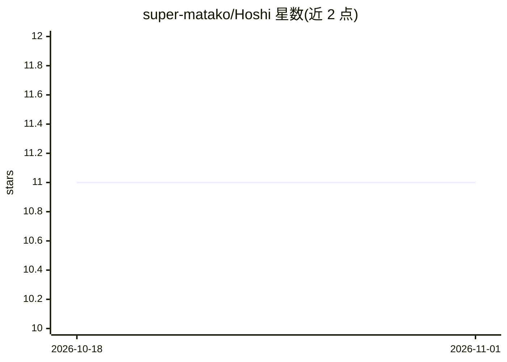

# super-matako/Hoshi

⭐ 11 · JavaScript · NOASSERTION · 推送 2026-06-03 · [GitHub](https://github.com/super-matako/Hoshi) · 个人维护

**围棋玩家用的 SGF 查看/编辑器与 KataGo 分析 GUI**

基于 Tauri 的桌面应用：打开与编辑 SGF 棋谱，提供标记工具、交互式提子/搬子编辑（自动重算后续分支局面）、撤消重做与主题定制。AI 功能为接入 KataGo 引擎做对局复盘：本地评估气泡、形势判断图，可设置 sweep 次数与访问深度；引擎可自带或用 Auto-setup 自动扫描系统并下载对应版本。Windows 下提供单文件便携 exe，从 Releases 页面下载。采用 PolyForm Noncommercial 1.0.0 许可。

## 筛选速览

| 维度 | 判定 | 备注 |
|---|---|---|
| AI 角色 | `ai-enhanced` | 去掉 AI 部分产品仍成立 |
| 许可风险 | `none` | NOASSERTION |
| 部署形态 | `desktop` | 安装包/桌面程序 |
| 模型依赖 | — | README 未给出锁定关系 |
| 硬件要求 | — | 无带数字的原话,不猜 |
| 安装摩擦 | `low` | 无编译、无系统依赖或容器化 |
| 成熟度 | — | 结构信号不足 |

## 能力要点

- SGF 查看/编辑与标记工具，支持搬子后自动重算后续分支
- 接入 KataGo 做本地评估气泡与形势判断图
- Auto-setup 自动扫描系统并下载 KataGo 引擎版本
- Tauri 单文件便携 exe（约 11.5 MB）

## 适用场景

- 用 KataGo 复盘自己的围棋对局
- 转录与整理 SGF 棋谱并做标记
- 对局中做形势判断与点目

## 场景标签

 · 领域:棋类/桌面工具

## 证据(README 行号)

> L3: A simple SGF viewer/editor and GUI for KataGo AI to analyze one's Go games.
> L8: * **Markup & Analysis:** SGF markup tools, local KataGo evaluation bubbles, and score estimation graphs.

## 星数曲线

2026-10-18 11 → 2026-11-01 11（+0）

---
*卡片 v1 · prompt 1.4 · 生成 2026-11-01 · 置信度 high · 依据 README sha `e54f64b81ad1` · [字段定义](../../DATASET.md)*
