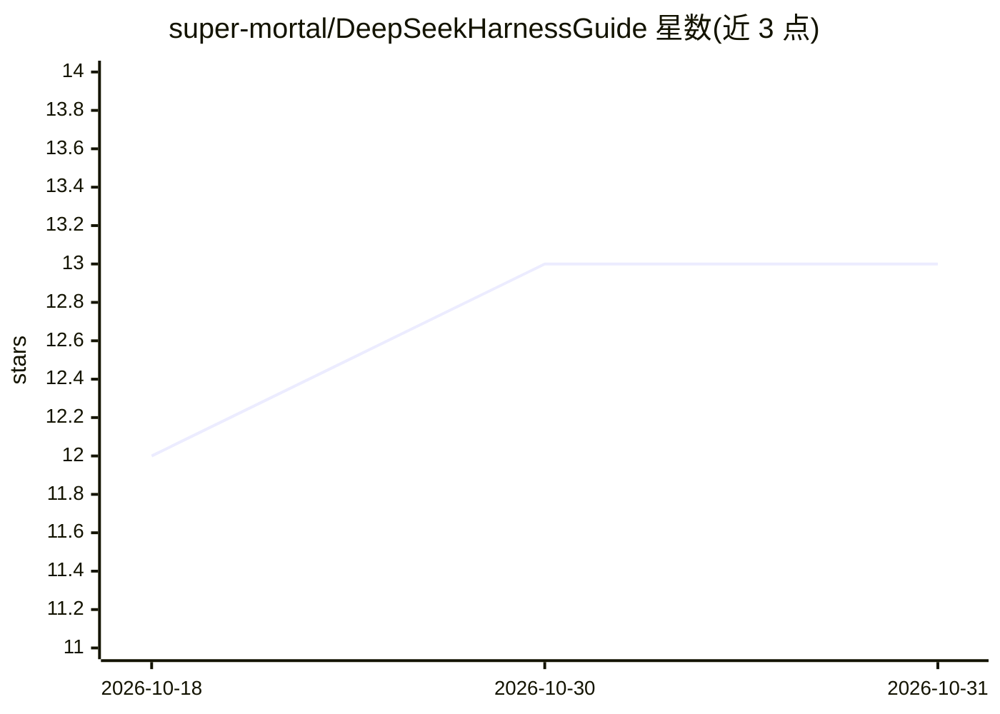

# super-mortal/DeepSeekHarnessGuide

⭐ 13 · MIT · 推送 2026-09-29 · [GitHub](https://github.com/super-mortal/DeepSeekHarnessGuide) · [官网](https://dsh.supermortal.top) · 个人维护 · 中文 README

**DeepSeek Harness (dsh) 实战教程站：从入门到插件发布的蓝皮书**

基于 VitePress 构建的 DeepSeek Harness (dsh) 中文教程文档站，内容围绕真实任务组织：从安装、插件树、Agent 组装（工具/沙箱/MCP/子代理）到插件编写发布与生产部署，共 7 个 PART 加附录。支持中/英/日/韩/西/葡 6 种语言，日常仅编辑中文，通过 changes.txt 记录变更后按命令触发翻译。E-INK 纸墨风格主题，含图片查看器，构建为静态站点可部署到任意静态托管。

## 筛选速览

| 维度 | 判定 | 备注 |
|---|---|---|
| AI 角色 | `ai-knowledge` | 知识聚合/清单类 |
| 许可风险 | `permissive` | MIT |
| 部署形态 | `library` | 以包/库形式分发 |
| 模型依赖 | — | README 未给出锁定关系 |
| 硬件要求 | — | 无带数字的原话,不猜 |
| 安装摩擦 | `low` | 无编译、无系统依赖或容器化 |
| 成熟度 | — | 结构信号不足 |

## 能力要点

- 按 PART 00-06 组织的 dsh 实战教程（安装/插件/MCP/部署等）
- 6 语言支持，中文为源语言，changes.txt 驱动的翻译工作流
- VitePress 构建，E-INK 风格主题与图片缩放查看器
- 静态站点输出，可部署到 Vercel/Netlify/GitHub Pages 等

## 适用场景

- 系统学习 DeepSeek Harness 从入门到插件开发
- 查阅 dsh 命令速查表与术语表
- 作为多语言技术文档站的工作流参考

## 场景标签

`教程课程` · 领域:学习与行业

## 证据(README 行号)

> L5: A practical **DeepSeek Harness (dsh)** guide built around real tasks. From your first working Agent to a reusable wo
> L13: - **Task-driven**: Every chapter comes from real hands-on practice — commands, screenshots, and errors are all real

## 星数曲线

2026-10-18 12 → 2026-10-31 13（+1）

---
*卡片 v1 · prompt 1.4 · 生成 2026-10-31 · 置信度 high · 依据 README sha `290849c9a326` · [字段定义](../../DATASET.md)*
