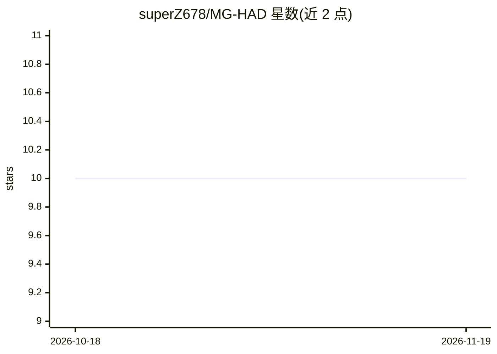

# superZ678/MG-HAD

⭐ 10 · MIT · 推送 2026-04-24 · [GitHub](https://github.com/superZ678/MG-HAD) · 组织维护 · 中文 README

**手部动作检测数据集与方法的论文配套仓库**

ACM MM '24 论文 Multi-Granularity Hand Action Detection 的官方仓库：发布 FHA-Kitchens 厨房场景手部动作数据集（2,377 视频片段、30,047 帧、约 20 万边界框、880 个动作类别，含粗/细粒度类别与交互区域定位标注），并介绍 MG-HAD 端到端多粒度手部动作检测方法（Multi-dimensional Action Queries 与 Coarse-Fine Contrastive Denoising 两个设计）。声明仅限研究用途，数据集与代码标注'即将发布'，README 未给出安装与运行说明。

## 筛选速览

| 维度 | 判定 | 备注 |
|---|---|---|
| AI 角色 | `ai-knowledge` | 知识聚合/清单类 |
| 许可风险 | `permissive` | MIT |
| 部署形态 | `None` |  |
| 模型依赖 | — | README 未给出锁定关系 |
| 硬件要求 | — | 无带数字的原话,不猜 |
| 安装摩擦 | `low` | 无编译、无系统依赖或容器化 |
| 成熟度 | `idea` | |

## 能力要点

- FHA-Kitchens 数据集：2,377 片段、880 类动作、约 20 万边界框标注
- 首个提供手部交互区域定位与多粒度类别标注的手部动作数据集
- MG-HAD 方法含 Multi-dimensional Action Queries 与 Coarse-Fine Contrastive Denoining 模块
- 论文已被 ACM Multimedia 2024 接收

## 适用场景

- 下载 FHA-Kitchens 数据集做手部动作检测研究
- 以 MG-HAD 作为多粒度动作检测任务的基线方法
- 了解厨房场景细粒度手部动作标注方式

## 场景标签

 · 领域:计算机视觉/视频动作检测

## 证据(README 行号)

> L14: - The paper "Multi-Granularity Hand Action Detection" has been accepted by the 32nd ACM International Conference on
> L20: To the best of our knowledge, we are the first to study the problem of multi-granularity hand action detection and 

## 星数曲线

2026-10-18 10 → 2026-11-19 10（+0）

---
*卡片 v1 · prompt 1.4 · 生成 2026-11-19 · 置信度 high · 依据 README sha `71c7e064a2b6` · [字段定义](../../DATASET.md)*
