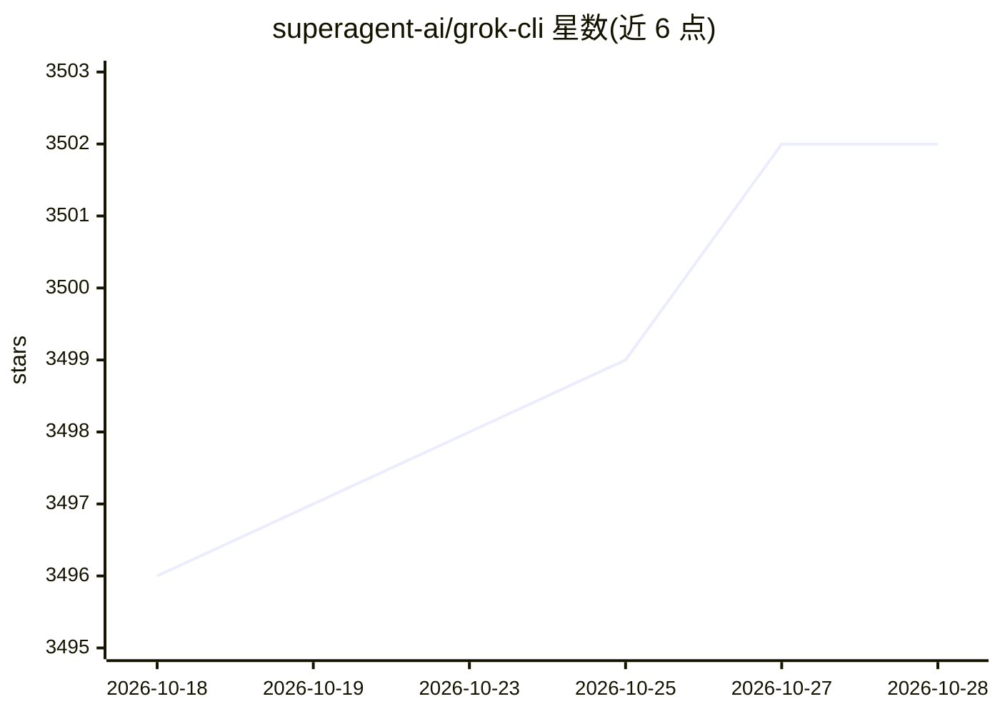

# superagent-ai/grok-cli

⭐ 3,502 · TypeScript · MIT · 推送 2026-07-06 · [GitHub](https://github.com/superagent-ai/grok-cli) · 组织维护

**面向开发者的终端 AI 编程代理，接入 xAI Grok API**

开源终端编程代理，TypeScript 编写，基于 Bun 与 OpenTUI 构建交互式终端 UI，连接 xAI Grok API 提供代码代理能力。功能包括：X 与 Web 实时搜索工具、图像/视频生成工具、默认开启的子代理（前台 task 委派与后台 delegate）、基于 agent-desktop 的 macOS 主机桌面自动化 computer 子代理、Telegram 远程遥控（含 Grok 语音转文字 API 转写语音消息）、定时任务、沙箱化 shell 执行（需 macOS 14+ Apple Silicon）、会话持久化、Headless --prompt 模式（含 JSON 事件流输出与 Batch API）、MCP 扩展与 Hooks 生命周期钩子。社区项目，与 xAI 无隶属关系。

## 筛选速览

| 维度 | 判定 | 备注 |
|---|---|---|
| AI 角色 | `ai-native` | 本体是模型或模型工具 |
| 许可风险 | `permissive` | MIT |
| 部署形态 | `None` |  |
| 模型依赖 | locked-api |  |
| 硬件要求 | — | 无带数字的原话,不猜 |
| 安装摩擦 | `medium` | 含编译或系统依赖之一 |
| 成熟度 | — | 结构信号不足 |

## 能力要点

- 内置 search_x / search_web 实时搜索工具
- 图像与视频生成作为聊天内 agent 工具
- Telegram 远程遥控与语音消息转写（Grok STT API）
- Shuru microVM 沙箱执行 shell 命令（macOS 14+ Apple Silicon）

## 适用场景

- 在终端里用自然语言完成代码修改、测试与重构
- CI/脚本中以 headless 模式批量运行编程任务
- 通过手机 Telegram 远程指挥本地运行的编程代理

## 场景标签

`编码 Agent` · 领域:编码与开发

## 证据(README 行号)

> L1: # grok-cli: an open-source coding agent for the Grok API
> L11: An open-source terminal coding agent that connects to xAI’s Grok API — real-time **X search**, **web search**, the 

## 星数曲线

2026-10-18 3,496 → 2026-10-28 3,502（+6）

---
*卡片 v1 · prompt 1.4 · 生成 2026-10-20 · 置信度 high · 依据 README sha `90141a07632f` · [字段定义](../../DATASET.md)*
