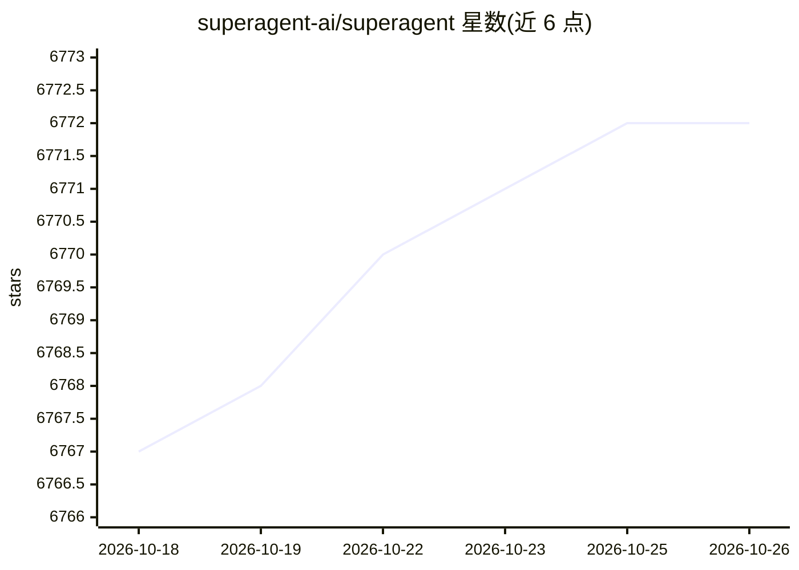

# superagent-ai/superagent

⭐ 6,772 · TypeScript · MIT · 推送 2026-08-25 · [GitHub](https://github.com/superagent-ai/superagent) · [官网](https://superagent.sh) · 组织维护

**面向 AI 应用的安全 SDK：防提示注入、脱敏、仓库扫描**

开源 SDK，为 AI agent 应用提供四类安全能力：Guard 在运行时检测并阻断提示注入、恶意指令与不安全工具调用；Redact 自动移除文本中的 PII/PHI 与密钥；Scan 分析仓库中的投毒与恶意指令；Test（红队测试）标注为即将推出。提供 TypeScript 与 Python SDK，另有 CLI 与可配合 Claude Code/Desktop 使用的 MCP Server。需在 superagent.sh 注册获取 API key；宣称兼容任意模型（OpenAI/Anthropic/Google/Groq/Bedrock 等），Guard 可用开放权重模型自托管运行（宣称 50-100ms 延迟）。MIT 许可，Y Combinator 背景。

## 筛选速览

| 维度 | 判定 | 备注 |
|---|---|---|
| AI 角色 | `ai-ecosystem` | LLM/agent 周边工具 |
| 许可风险 | `permissive` | MIT |
| 部署形态 | `library` | 以包/库形式分发 |
| 模型依赖 | — | README 未给出锁定关系 |
| 硬件要求 | — | 无带数字的原话,不猜 |
| 安装摩擦 | `low` | 无编译、无系统依赖或容器化 |
| 成熟度 | `idea` | |

## 能力要点

- 运行时检测并阻断提示注入、恶意指令与不安全工具调用
- 自动移除 PII/PHI 与密钥的 Redact 功能
- 扫描仓库中的 agent 定向攻击（repo poisoning 等）
- 提供 TypeScript/Python SDK、CLI 与 MCP Server 三种接入方式

## 适用场景

- 在我的 AI 应用运行时拦截提示注入与恶意指令
- 上线前对依赖仓库做投毒与恶意指令扫描
- 对进出模型的数据做 PII 与密钥脱敏

## 场景标签

`网络安全` · 领域:学习与行业

## 证据(README 行号)

> L21: An open-source SDK for AI agent safety. Block prompt injections, redact PII and secrets, scan repositories for thre
> L27: Detect and block prompt injections, malicious instructions, and unsafe tool calls at runtime.

## 星数曲线

2026-10-18 6,767 → 2026-10-26 6,772（+5）

---
*卡片 v1 · prompt 1.4 · 生成 2026-10-20 · 置信度 mid · 依据 README sha `b8d36ad4bba2` · [字段定义](../../DATASET.md)*
