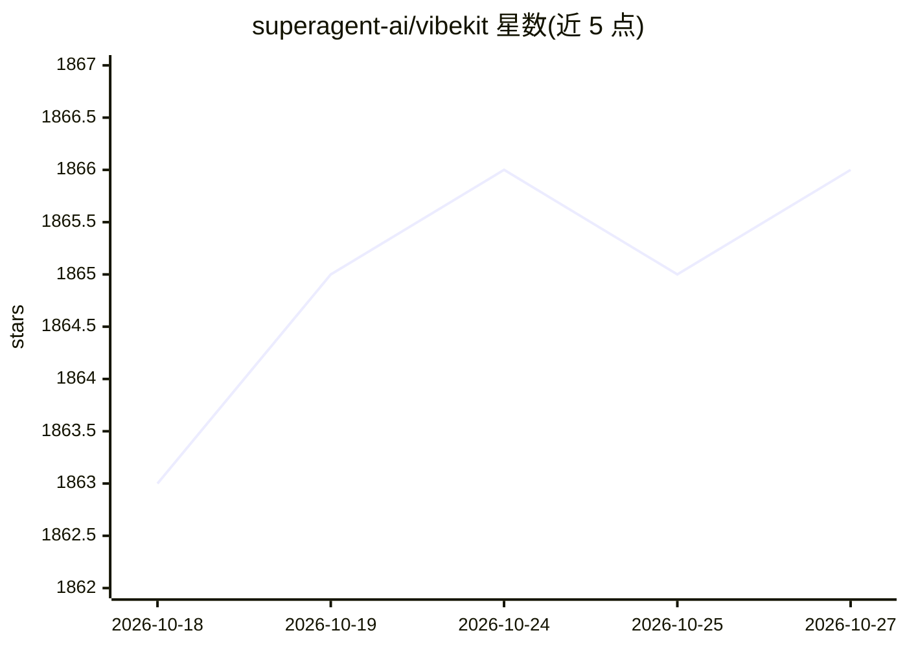

# superagent-ai/vibekit

⭐ 1,866 · TypeScript · MIT · 推送 2026-01-13 · [GitHub](https://github.com/superagent-ai/vibekit) · [官网](https://vibekit.sh) · 组织维护

**在隔离沙箱中安全运行编码代理的 CLI 工具**

面向使用 Claude Code、Gemini CLI、Codex CLI 等编码代理的开发者：VibeKit 以 CLI 形式（npm 全局安装 vibekit）在本地 Docker 隔离容器中运行代理输出，内置敏感数据（密钥、API key）自动脱敏，并提供实时日志、追踪与指标的可观测性。声明可离线本地运行、无云依赖。另提供 SDK 包（在应用中安全执行 AI 生成代码）与 Auth 包（在 AI 应用中使用 MAX 订阅认证）。MIT 许可，由 Superagent Technologies Inc. 维护。

## 筛选速览

| 维度 | 判定 | 备注 |
|---|---|---|
| AI 角色 | `ai-ecosystem` | LLM/agent 周边工具 |
| 许可风险 | `permissive` | MIT |
| 部署形态 | `library` | 以包/库形式分发 |
| 模型依赖 | locked-api |  |
| 硬件要求 | — | 无带数字的原话,不猜 |
| 安装摩擦 | `low` | 无编译、无系统依赖或容器化 |
| 成熟度 | — | 结构信号不足 |

## 能力要点

- 在 Docker 隔离容器中运行编码代理输出
- 自动脱敏密钥与 API key 等敏感数据
- 实时日志、追踪与指标的可观测性
- 支持 Claude Code、Gemini CLI、Grok CLI、Codex CLI、OpenCode 等

## 适用场景

- 安全地在本地沙箱运行 Claude Code 等编码代理
- 防止代理输出中的密钥与敏感数据泄露
- 监控编码代理的运行日志与指标

## 场景标签

`LLM 可观测性` · 领域:评测与运维

## 证据(README 行号)

> L3: Run Claude Code, Gemini, Codex — or any coding agent — in a clean, isolated sandbox with sensitive data redaction an
> L29: 🌐 **Universal agent support** - Works with Claude Code, Gemini CLI, Grok CLI, Codex CLI, OpenCode, and more
> L23: 🐳 **Local sandbox** - Runs agent output in isolated Docker containers — zero risk to your local setup

## 星数曲线

2026-10-18 1,863 → 2026-10-27 1,866（+3）

---
*卡片 v1 · prompt 1.4 · 生成 2026-10-21 · 置信度 high · 依据 README sha `9e039354423a` · [字段定义](../../DATASET.md)*
