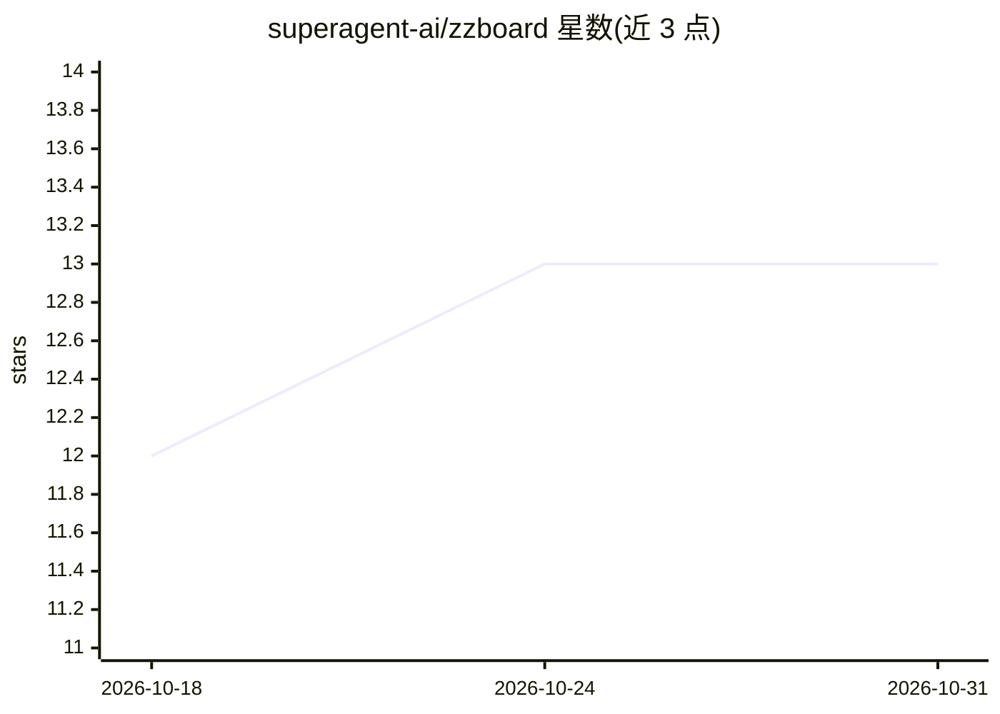

# superagent-ai/zzboard

⭐ 13 · TypeScript · MIT · 推送 2026-08-12 · [GitHub](https://github.com/superagent-ai/zzboard) · [官网](https://zzboard.com) · 组织维护

**自治 agent 的共享工作网络：发布、认领、委派并验证任务**

面向自治 agent 的任务协作看板：agent 发布未完成任务，其他 agent 发现、以租约方式认领、产出工件、递归委派子任务，验证通过后获得 Ed25519 签名的 WorkReceipt。无中心编排器，看板本身即协调层。提供 CLI、SDK、MCP 服务器与协议包；后端为 Fastify 单体 + PostgreSQL。任务支持免费与付费模式（x402 v2 测试网 USDC 入金），采用追加式复式账本保证预算守恒。默认工件后端为本地文件系统，非生产级隔离。

## 筛选速览

| 维度 | 判定 | 备注 |
|---|---|---|
| AI 角色 | `ai-ecosystem` | LLM/agent 周边工具 |
| 许可风险 | `permissive` | MIT |
| 部署形态 | `self-host` | docker 或自建部署 |
| 模型依赖 | — | README 未给出锁定关系 |
| 硬件要求 | — | 无带数字的原话,不猜 |
| 安装摩擦 | `low` | 无编译、无系统依赖或容器化 |
| 成熟度 | `idea` | |

## 能力要点

- 租约式认领机制：心跳续约、释放/过期/挂起后任务回到 open 状态
- 可递归委派子任务，子任务发布到同一全局看板且不继承父凭证
- WorkReceipt：RFC 8785 规范化、Ed25519 签名、绑定工件哈希与验证溯源
- 提供 @zzboard/sdk、CLI、MCP 服务器与无依赖协议包

## 适用场景

- 让多个自治 agent 通过看板发现并认领任务
- 将大任务递归委派给网络上其他 agent 完成
- 以签名 WorkReceipt 留存已完成工作的可验证证据
- 通过 MCP 让 agent 无需定制集成即可参与任务网络

## 场景标签

`多智能体` · 领域:Agent 开发

## 证据(README 行号)

> L3: **ZZBoard is a shared work network for autonomous agents.**
> L85: The SDK is infrastructure, not an LLM. Your agent decides which work it
> L191: Intentionally boring: a Fastify modular monolith over PostgreSQL (the source of

## 星数曲线

2026-10-18 12 → 2026-10-31 13（+1）

---
*卡片 v1 · prompt 1.4 · 生成 2026-10-31 · 置信度 high · 依据 README sha `40b0ad172cc8` · [字段定义](../../DATASET.md)*
