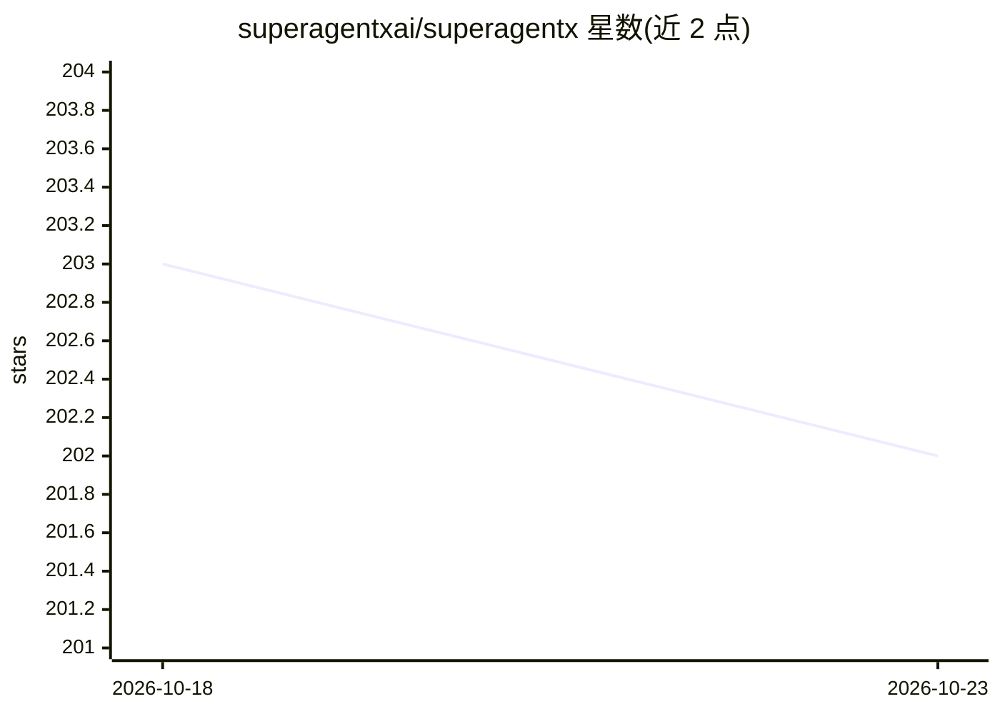

# superagentxai/superagentx

⭐ 202 · Python · MIT · 推送 2026-09-15 · [GitHub](https://github.com/superagentxai/superagentx) · [官网](https://superagentx.ai) · 组织维护

**开源模块化 agentic AI 框架：规划执行工作流并内置人工审批治理**

面向构建多智能体应用的 Python 开源框架。智能体可规划多步执行、动态调用工具、串行或并行运行工作流并支持重试反思；支持 100+ LLM（OpenAI、Azure OpenAI、Gemini、Claude、Bedrock 及开源模型）与 10,000+ MCP 工具，内置基于 Playwright 的浏览器自动化。核心机制是 Human Approval Governance Agent：敏感操作前暂停并请求人工批准，决策持久化用于审计。执行状态、记忆与审计日志存于 SQLite 或 PostgreSQL，通过 pip 安装，需 Python 3.12+。

## 筛选速览

| 维度 | 判定 | 备注 |
|---|---|---|
| AI 角色 | `ai-ecosystem` | LLM/agent 周边工具 |
| 许可风险 | `permissive` | MIT |
| 部署形态 | `library` | 以包/库形式分发 |
| 模型依赖 | locked-api |  |
| 硬件要求 | — | 无带数字的原话,不猜 |
| 安装摩擦 | `low` | 无编译、无系统依赖或容器化 |
| 成熟度 | — | 结构信号不足 |

## 能力要点

- 多步工作流执行，串行/并行/混合智能体通信与重试机制
- 人工审批治理智能体：敏感操作前暂停请求批准并持久化决策
- 支持 100+ LLM 与 10,000+ MCP 工具
- 基于 Playwright 的浏览器智能体与 Agentic RPA（浏览器及桌面自动化）

## 适用场景

- 构建需要人工审批敏感步骤的自主智能体工作流
- 让智能体操作浏览器、API、数据库完成业务流程
- 企业部署带审计日志与记忆持久化的多智能体系统

## 场景标签

`多智能体` `浏览器自动化` `GUI 自动化` · 领域:Agent 开发

## 证据(README 行号)

> L1: **SuperAgentX**: is an open-source, modular agentic AI framework that enables AI agents to plan, act, and execute re
> L26: ### 🔹 Massive Model & Tool Support

## 星数曲线

2026-10-18 203 → 2026-10-23 202（-1）

---
*卡片 v1 · prompt 1.4 · 生成 2026-10-22 · 置信度 high · 依据 README sha `5f5144062524` · [字段定义](../../DATASET.md)*
