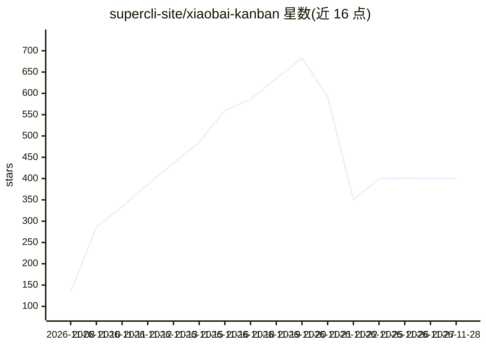

# supercli-site/xiaobai-kanban

⭐ 400 · HTML · MIT · 推送 2026-11-27 · [GitHub](https://github.com/supercli-site/xiaobai-kanban) · [官网](https://xiaobai.supercli.site) · 个人维护 · 中文 README

**面向零基础用户的中文 AI 编程入门教程站**

以中文教程站形式组织的 AI 编程入门路径，按五个阶段编排：认识 Agent、第一次实战、免费额度方案（magpie 本地网关 + 国内模型免费额度）、安装 Git 与 GitLab/GitHub CLI 等 CLI 工具、需求表达与 vibe coding 方法论。同时维护作者自研的 21 个配套工具（kyvault、scorecard 等）与第三方工具（Claude Code、Codex、Kun、Superpowers、DSH 插件）的场景化推荐清单，附各工具安装方式。学习路径与工具箱均以链接导航为主，本体不含可安装的软件包。

## 筛选速览

| 维度 | 判定 | 备注 |
|---|---|---|
| AI 角色 | `ai-knowledge` | 知识聚合/清单类 |
| 许可风险 | `permissive` | MIT |
| 部署形态 | `library` | 以包/库形式分发 |
| 模型依赖 | — | README 未给出锁定关系 |
| 硬件要求 | — | 无带数字的原话,不猜 |
| 安装摩擦 | `low` | 无编译、无系统依赖或容器化 |
| 成熟度 | — | 结构信号不足 |

## 能力要点

- 五阶段学习路径：认识 Agent→实战→免费方案→CLI 工具→vibe coding 方法论
- 介绍用 magpie 本地网关配合国内模型免费额度零成本使用 Agent
- 按六个场景组织的工具箱，覆盖密钥管理、出图、前端开发、插件等
- AGENTS.md 配合手册与需求表达四要素模板

## 适用场景

- 零代码基础想开始让 Agent 帮我写代码
- 想用免费模型额度先不付费试用 AI 编程
- 不知道该装哪些 CLI 工具、按场景挑工具

## 场景标签

`教程课程` · 领域:学习与行业

## 证据(README 行号)

> L3: # 🧭 小白看板 — 让 Agent 帮你写代码
> L29: ### 🌱 第一步：认识 Agent
> L75: |从「我不会」到「代码上线」|15 分钟|Agent 是什么 · GitLab/GitHub 区别 · 代码怎么交 · 代码怎么认 · Web 开发与代码工程 · 开发在干嘛 · 命令是什么|

## 星数曲线

2026-11-08 134 → 2026-11-28 400（+266）

---
*卡片 v1 · prompt 1.4 · 生成 2026-11-28 · 置信度 mid · 依据 README sha `98dc29829adb` · [字段定义](../../DATASET.md)*
