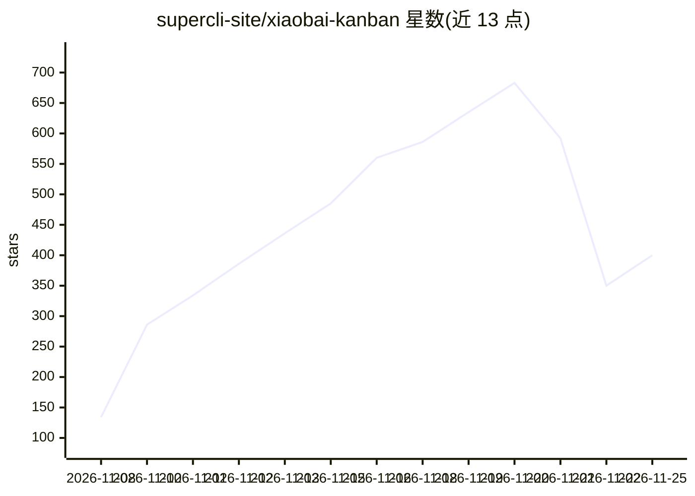

# supercli-site/xiaobai-kanban

⭐ 400 · HTML · MIT · 推送 2026-11-22 · [GitHub](https://github.com/supercli-site/xiaobai-kanban) · [官网](https://xiaobai.supercli.site) · 个人维护 · 中文 README

**面向零基础用户的中文 AI 编程助手入门教程站**

教程型文档站点（VitePress 风格 README），教不写代码的用户认识 Agent、表达需求（背景+目标+范围+验收四句公式）、安装 Git/GitLab CLI/GitHub CLI 并掌握 Git 工作流。内容按学习路径分步组织，覆盖免费模型额度方案（magpie 本地网关 + 国内模型免费额度）、vibe coding 小步节奏与验收红线。另按六个场景收录作者维护的约 21 个配套工具（密钥管理、出图、插件等）并给出安装方式。

## 筛选速览

| 维度 | 判定 | 备注 |
|---|---|---|
| AI 角色 | `ai-knowledge` | 知识聚合/清单类 |
| 许可风险 | `permissive` | MIT |
| 部署形态 | `library` | 以包/库形式分发 |
| 模型依赖 | — | README 未给出锁定关系 |
| 硬件要求 | — | 无带数字的原话,不猜 |
| 安装摩擦 | `low` | 无编译、无系统依赖或容器化 |
| 成熟度 | — | 结构信号不足 |

## 能力要点

- 五步学习路径：认识 Agent → 动手实战 → 装工具学流程 → 全貌 → 进阶
- 免费方案：用 magpie 本地网关配国内模型免费额度实现零成本 AI 编程
- 需求表达四要素公式与配套填空模板、自检清单
- 按六个场景收录 21 个配套工具及各自安装方式

## 适用场景

- 零基础想用 AI 写代码但不懂命令行的用户按路径自学
- 学会把需求讲清楚，减少与 Agent 来回返工
- 不想订阅付费服务，寻找免费模型额度的使用方案

## 场景标签

`教程课程` · 领域:学习与行业

## 证据(README 行号)

> L3: # 🧭 小白看板 — 让 Agent 帮你写代码
> L27: ## 🗺️ 学习路径
> L61: ### 🛠️ 第三步：装工具、学流程

## 星数曲线

2026-11-08 134 → 2026-11-25 400（+266）

---
*卡片 v1 · prompt 1.4 · 生成 2026-11-17 · 置信度 mid · 依据 README sha `22950b3399d3` · [字段定义](../../DATASET.md)*
