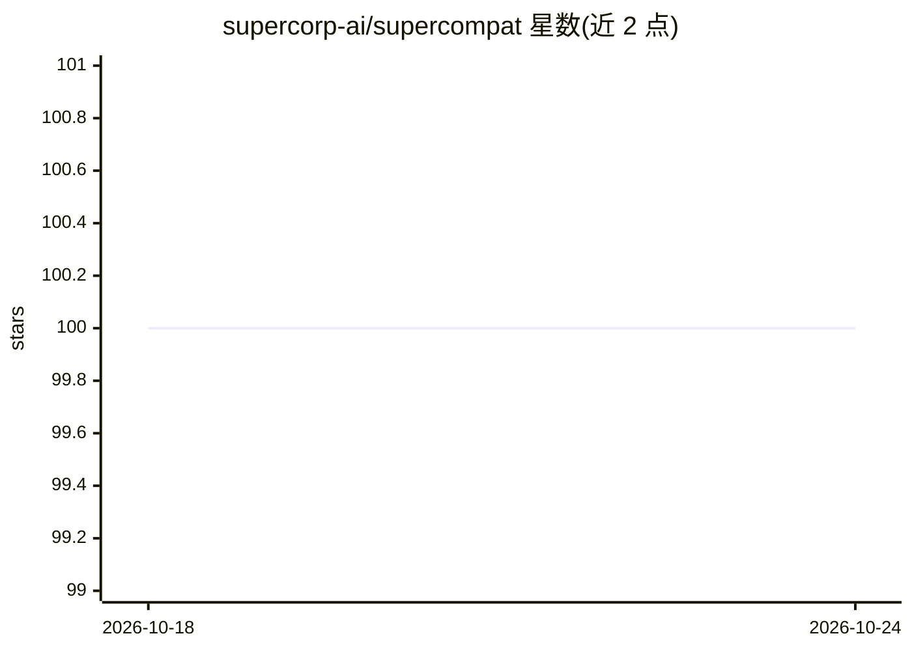

# supercorp-ai/supercompat

⭐ 100 · TypeScript · MIT · 推送 2026-08-13 · [GitHub](https://github.com/supercorp-ai/supercompat) · [官网](https://supercompat.com) · 组织维护

**TypeScript 库：用 OpenAI/Anthropic SDK 调用任意 LLM 供应商**

进程内运行的 AI 兼容层，以 TypeScript 库形式提供。通过在 SDK 实例上安装自定义 fetch，拦截 OpenAI SDK（或 Anthropic SDK）调用并翻译为其他供应商请求，覆盖 Anthropic、Google、Groq、Mistral、Together、OpenRouter、Perplexity、Ollama、Azure 等，保留原 SDK 类型，无需代理服务器。状态默认存内存，可换 Prisma 适配器持久化到 Postgres；支持流式输出、工具调用。面向需要在多供应商间切换的开发者。

## 筛选速览

| 维度 | 判定 | 备注 |
|---|---|---|
| AI 角色 | `ai-ecosystem` | LLM/agent 周边工具 |
| 许可风险 | `permissive` | MIT |
| 部署形态 | `library` | 以包/库形式分发 |
| 模型依赖 | — | README 未给出锁定关系 |
| 硬件要求 | — | 无带数字的原话,不猜 |
| 安装摩擦 | `low` | 无编译、无系统依赖或容器化 |
| 成熟度 | — | 结构信号不足 |

## 能力要点

- 通过 OpenAI/Anthropic SDK 调用任意 LLM 供应商，保留原类型
- 进程内路由，无代理服务器、无额外转发
- Prisma 存储适配器可将对话/线程/运行持久化到 Postgres
- 支持流式输出与 function calling、web search 等工具

## 适用场景

- 换一个适配器即可在 LLM 供应商之间切换
- 统一代码库调用多家供应商并保留 OpenAI SDK 类型
- 持久化 conversations/threads/runs 状态到 Postgres

## 场景标签

`模型网关` · 领域:Agent 开发

## 证据(README 行号)

> L3: Supercompat is an AI compatibility layer without compromises. A TypeScript library that lets you call **any LLM prov
> L5: It runs in-process. No proxy server, no request forwarding, no extra latency. Supercompat installs a custom `fetch` 

## 星数曲线

2026-10-18 100 → 2026-10-24 100（+0）

---
*卡片 v1 · prompt 1.4 · 生成 2026-10-23 · 置信度 high · 依据 README sha `1ea3be7ab9a9` · [字段定义](../../DATASET.md)*
