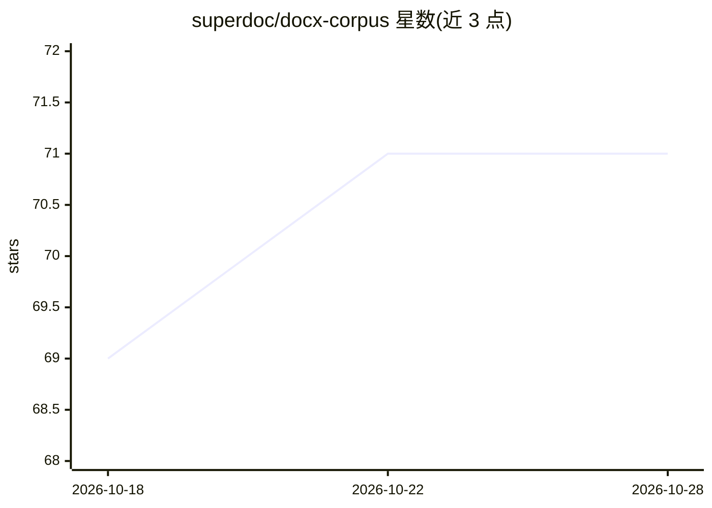

# superdoc/docx-corpus

⭐ 71 · TypeScript · MIT · 推送 2026-10-19 · [GitHub](https://github.com/superdoc/docx-corpus) · [官网](https://docxcorp.us) · 组织维护

**73.6万+ 真实 Word 文档的分类语料库及构建流水线**

由 SuperDoc 构建的开放 docx 文档语料库：从 Common Crawl 索引筛选 .docx URL，抓取、校验、去重后存入 R2，用 Docling 抽取文本、lingua 检测语言，再以微调 XLM-RoBERTa 模型标注文档类型与主题，最终以 Parquet 格式发布元数据到 Hugging Face，并提供 API 查询。同时开源完整构建流水线：Bun CLI、AWS Lambda 的 cdx-filter、Cloudflare Worker API 与站点；需 Bun 与 Docker 运行，部分命令依赖 R2/AWS 凭证，标注训练数据可选使用 ANTHROPIC_API_KEY。旧抓取版本存在 ZIP 数据后多余 4 字节问题，提供修复脚本。

## 筛选速览

| 维度 | 判定 | 备注 |
|---|---|---|
| AI 角色 | `ai-knowledge` | 知识聚合/清单类 |
| 许可风险 | `permissive` | MIT |
| 部署形态 | `self-host` | docker 或自建部署 |
| 模型依赖 | — | README 未给出锁定关系 |
| 硬件要求 | — | 无带数字的原话,不猜 |
| 安装摩擦 | `low` | 无编译、无系统依赖或容器化 |
| 成熟度 | — | 结构信号不足 |

## 能力要点

- 736K+ 来自公共网络的真实 docx 文档，已分类并以 MIT 许可开放
- Common Crawl→过滤→抓取→抽取→分类→导出的完整流水线
- 微调 XLM-RoBERTa 模型标注文档类型与主题
- 元数据以 Parquet 发布至 Hugging Face，并提供 API 访问

## 适用场景

- 获取带类型与主题标签的真实 Word 文档语料做 NLP 研究
- 复现或自定义 docx 语料抓取与分类流水线
- 文档处理模型的训练数据来源

## 场景标签

 · 领域:NLP/数据集

## 证据(README 行号)

> L5:  736K+ real Word documents from the public web, classified and open.
> L35: 5. **export**: publishes the metadata to Hugging Face as Parquet.

## 星数曲线

2026-10-18 69 → 2026-10-28 71（+2）

---
*卡片 v1 · prompt 1.4 · 生成 2026-10-24 · 置信度 high · 依据 README sha `7b2fbe30d8ba` · [字段定义](../../DATASET.md)*
