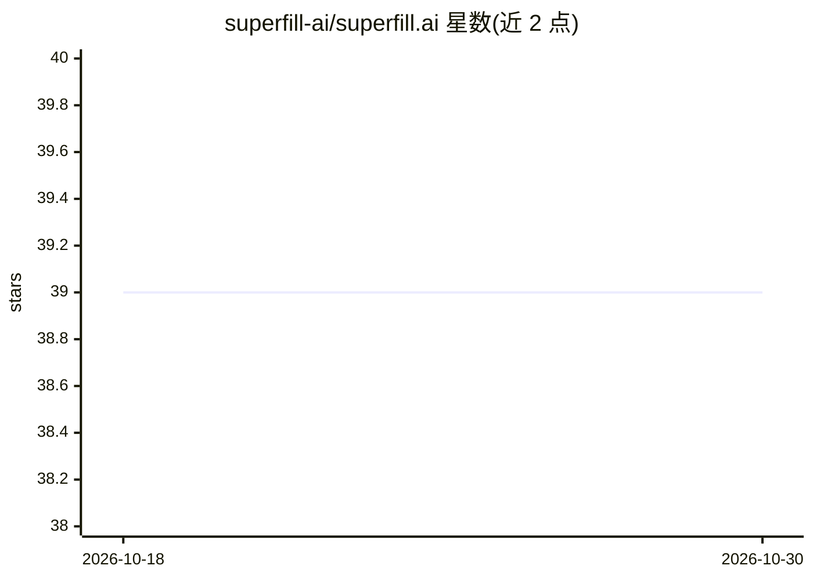

# superfill-ai/superfill.ai

⭐ 39 · TypeScript · NOASSERTION · 推送 2026-07-01 · [GitHub](https://github.com/superfill-ai/superfill.ai) · [官网](https://superfill.ai) · 个人维护

**跨浏览器 AI 表单自动填充扩展：记忆信息一次，处处填充**

基于 WXT/React/TypeScript 的浏览器扩展，存储问答式记忆（含 AI 自动分类、打标签、置信度评分），检测网页表单字段后将字段与记忆做上下文匹配并自动填入，支持 input/textarea 及 select/radio/checkbox/date 字段。采用 BYOK 模式，用户自带 OpenAI、Anthropic、Google、Groq、DeepSeek、Ollama 等提供商的 API key，数据本地存储，API key 经 AES-GCM 加密。通过 Chrome Web Store 与 Firefox Add-ons 安装，Phase 2 部分功能（Safari、云同步、多设备）尚未完成。

## 筛选速览

| 维度 | 判定 | 备注 |
|---|---|---|
| AI 角色 | `ai-enhanced` | 去掉 AI 部分产品仍成立 |
| 许可风险 | `none` | NOASSERTION |
| 部署形态 | `None` |  |
| 模型依赖 | local-ok | 支持本地模型 |
| 硬件要求 | — | 无带数字的原话,不猜 |
| 安装摩擦 | `low` | 无编译、无系统依赖或容器化 |
| 成熟度 | `idea` | |

## 能力要点

- 字段级上下文匹配与置信度评分的自动填充引擎
- BYOK 多提供商支持（OpenAI/Anthropic/Google/Groq/DeepSeek/Ollama）
- 本地优先存储，API key AES-GCM 加密，零遥测
- 记忆 CSV 导入导出与多标签筛选

## 适用场景

- 填写求职申请、租房、问卷等重复性表单时自动带入个人信息
- 集中管理常用问答信息并跨网站复用
- 用自己的 API key 驱动 AI 填表，数据留在本地

## 场景标签

`浏览器自动化` · 领域:效率与自动化

## 证据(README 行号)

> L3: > An AI-powered browser extension that stores your information once and intelligently auto-fills forms across any we
> L15: Superfill.ai is a cross-browser memory extension that eliminates repetitive data entry by creating an intelligent m
> L37: - **Contextual Matching**: AI matches form fields to stored memories based on context

## 星数曲线

2026-10-18 39 → 2026-10-30 39（+0）

---
*卡片 v1 · prompt 1.4 · 生成 2026-10-25 · 置信度 high · 依据 README sha `8550d70e074b` · [字段定义](../../DATASET.md)*
