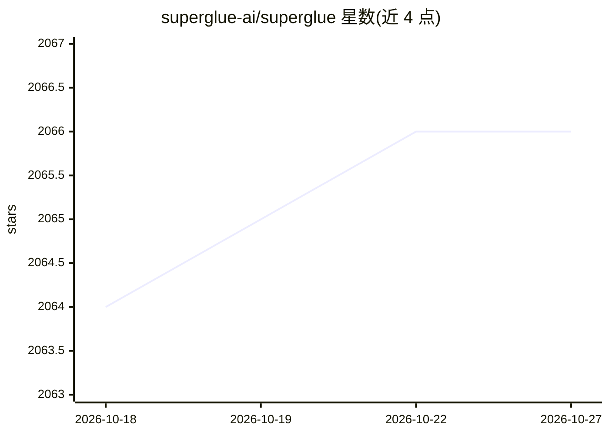

# superglue-ai/superglue

⭐ 2,066 · TypeScript · NOASSERTION · 推送 2026-10-26 · [GitHub](https://github.com/superglue-ai/superglue) · [官网](https://superglue.ai) · 组织维护

**用自然语言构建企业系统集成与工具的 AI agent 平台**

superglue 是面向企业系统集成的 AI agent 平台：通过自然语言描述，agent 完成系统对接、数据迁移与实现工作，覆盖 ERP、CRM、数据库、支付、客服等长尾及企业系统（REST/GraphQL/SOAP/文件/数据库均可接入）。产品从企业知识中学习系统运作方式，可连接内部系统到 Claude 等 AI 平台并提供治理的数据访问。提供云托管与自托管两种使用方式，客户端 SDK 为 MIT 许可，本体为 FSL 许可（源码可用但限制商用竞争用途）。

## 筛选速览

| 维度 | 判定 | 备注 |
|---|---|---|
| AI 角色 | `ai-ecosystem` | LLM/agent 周边工具 |
| 许可风险 | `none` | NOASSERTION |
| 部署形态 | `None` |  |
| 模型依赖 | — | README 未给出锁定关系 |
| 硬件要求 | — | 无带数字的原话,不猜 |
| 安装摩擦 | `low` | 无编译、无系统依赖或容器化 |
| 成熟度 | — | 结构信号不足 |

## 能力要点

- 自然语言描述即可生成集成，agent 端到端管理实施过程
- 支持 ERP 实施/迁移（NetSuite、SAP、Sage Intacct 等）
- 为 AI agent 提供受治理的企业数据访问与用量追踪
- 云托管或自托管（自有基础设施）两种部署方式

## 适用场景

- 用自然语言完成 Sage Intacct/NetSuite 等系统的数据映射与迁移
- 把 ERP、CRM、数据库等内部系统接入 Claude 等 AI 平台
- 跨多种技术栈的客户系统统一为一个集成层完成 onboarding

## 场景标签

`Agent 框架` `工作流自动化` · 领域:Agent 开发

## 证据(README 行号)

> L3:  superglue's AI agents connect, migrate and implement enterprise systems. Cloud-hosted or on your own infrastructure
> L12: superglue learns how your systems work from your company's knowledge. It performs the implementation that normally 
> L15: - Connect ERP, CRM, databases, and internal systems to AI platforms like Claude. Create governed data access for AI

## 星数曲线

2026-10-18 2,064 → 2026-10-27 2,066（+2）

---
*卡片 v1 · prompt 1.4 · 生成 2026-10-21 · 置信度 high · 依据 README sha `813f2919c4e9` · [字段定义](../../DATASET.md)*
