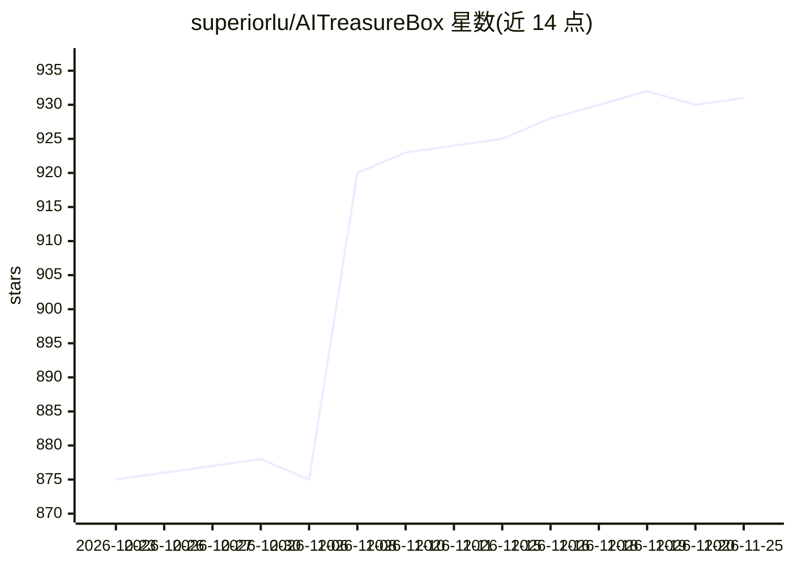

# superiorlu/AITreasureBox

⭐ 931 · Ruby · GPL-3.0 · 推送 2026-11-24 · [GitHub](https://github.com/superiorlu/AITreasureBox) · 个人维护 · 中文 README

**自动更新排序的实用 AI 仓库/工具/论文/教程聚合清单**

以 GitHub 仓库形式维护的 AI 资源目录，收录仓库、工具、网站、论文与教程，通过 GitHub Workflow 每 2 小时自动更新条目的星标数并自动重新排序。内容为单表目录形式，含中英双语版本入口，README 说明简介文字由 ChatGPT 翻译、配图来自 Midjourney。使用者通过阅读清单发现资源，本身不提供安装命令、运行时或 API。

## 筛选速览

| 维度 | 判定 | 备注 |
|---|---|---|
| AI 角色 | `ai-knowledge` | 知识聚合/清单类 |
| 许可风险 | `viral` | GPL-3.0 |
| 部署形态 | `library` | 以包/库形式分发 |
| 模型依赖 | — | README 未给出锁定关系 |
| 硬件要求 | — | 无带数字的原话,不猜 |
| 安装摩擦 | `medium` | 含编译或系统依赖之一 |
| 成熟度 | — | 结构信号不足 |

## 能力要点

- GitHub Workflow 每 2 小时自动更新星标并重新排序
- 收录仓库、工具、网站、论文与教程多类资源
- 提供中英双语版本入口

## 适用场景

- 查找与浏览热门 AI 相关开源仓库
- 按星标排序了解 AI 工具生态动态
- 作为检索 AI 教程与论文的索引

## 场景标签

`精选清单` · 领域:学习与行业

## 证据(README 行号)

> L5:  Collect practical AI repos, tools, websites, papers and tutorials on AI.
> L15: > updated repos and stars every 2 hours and re-ranking automatically.

## 星数曲线

2026-10-23 875 → 2026-11-25 931（+56）

---
*卡片 v1 · prompt 1.4 · 生成 2026-11-25 · 置信度 mid · 依据 README sha `bcd7adb7f8d1` · [字段定义](../../DATASET.md)*
