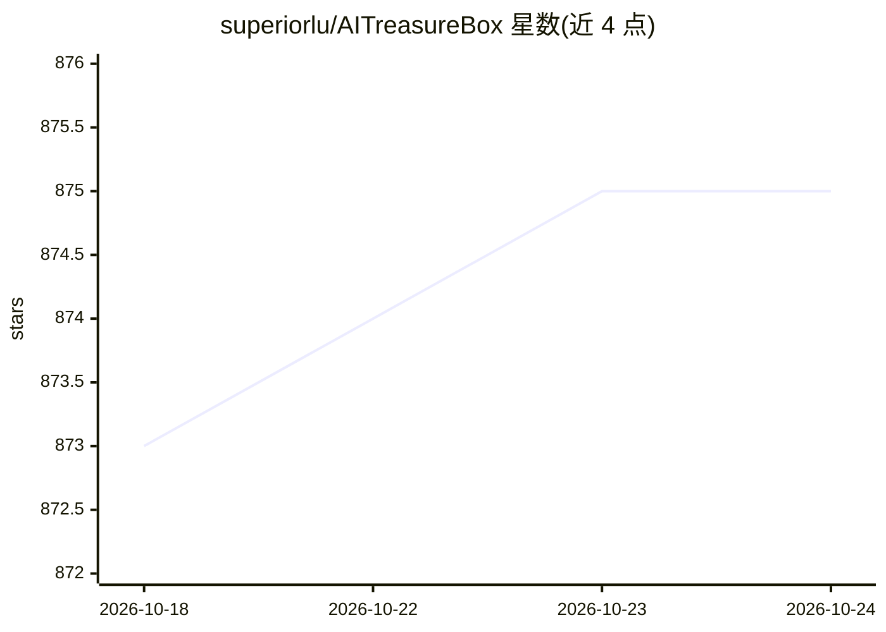

# superiorlu/AITreasureBox

⭐ 875 · Ruby · GPL-3.0 · 推送 2026-10-24 · [GitHub](https://github.com/superiorlu/AITreasureBox) · 个人维护 · 中文 README

**AI 百宝箱：自动采集并排名 AI 仓库/工具/论文/教程清单**

一个 awesome-list 形式的 AI 资源聚合仓库：通过自动化流程每 2 小时更新所收录仓库的 star 数并重新排名，条目涵盖 AI 仓库、工具、网站、论文与教程。README 以中英双语呈现，主要形态为带编号、日期与 star 数的仓库表格，描述文字部分由 ChatGPT 翻译。内容混排 AI 相关与非 AI 高星仓库（如 vscode、next.js、fastapi）。

## 筛选速览

| 维度 | 判定 | 备注 |
|---|---|---|
| AI 角色 | `ai-knowledge` | 知识聚合/清单类 |
| 许可风险 | `viral` | GPL-3.0 |
| 部署形态 | `None` |  |
| 模型依赖 | — | README 未给出锁定关系 |
| 硬件要求 | — | 无带数字的原话,不猜 |
| 安装摩擦 | `medium` | 含编译或系统依赖之一 |
| 成熟度 | — | 结构信号不足 |

## 能力要点

- 每 2 小时自动更新收录仓库的 star 数并重新排名
- 覆盖 AI 仓库、工具、网站、论文与教程五类资源
- 中英双语 README

## 适用场景

- 浏览当前高 star 的 AI 相关仓库排行
- 发现 AI 工具、论文与教程资源
- 按时间与热度跟踪 AI 仓库动态

## 场景标签

`精选清单` · 领域:学习与行业

## 证据(README 行号)

> L5:  Collect practical AI repos, tools, websites, papers and tutorials on AI.
> L15: > updated repos and stars every 2 hours and re-ranking automatically.

## 星数曲线

2026-10-18 873 → 2026-10-24 875（+2）

---
*卡片 v1 · prompt 1.4 · 生成 2026-10-21 · 置信度 high · 依据 README sha `ab11259eeebc` · [字段定义](../../DATASET.md)*
