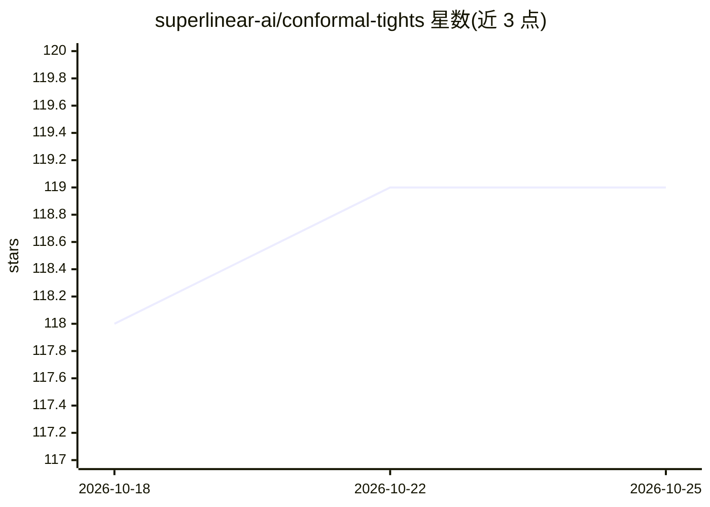

# superlinear-ai/conformal-tights

⭐ 119 · Python · MIT · 推送 2026-05-01 · [GitHub](https://github.com/superlinear-ai/conformal-tights) · 组织维护

**为 sklearn 回归器与 Darts 预测器提供保形分位数与区间预测的 Python 包**

Conformal Tights 是一个 Python 包，导出两个组件：scikit-learn 元估计器 ConformalCoherentQuantileRegressor，为任意 scikit-learn 回归器添加共形保形校准的分位数与区间预测方法（predict_quantiles / predict_interval）；以及 DartsForecaster，基于前者实现概率式时间序列预测。关键机制是 Coherent Conformal Prediction：保证分位数单调不交叉，采用绝对与相对残差的两级校准，选取满足目标覆盖率的最低离散度，仅需少量校准样本。支持 pandas DataFrame 输入输出。

## 筛选速览

| 维度 | 判定 | 备注 |
|---|---|---|
| AI 角色 | `ai-native` | 本体是模型或模型工具 |
| 许可风险 | `permissive` | MIT |
| 部署形态 | `library` | 以包/库形式分发 |
| 模型依赖 | — | README 未给出锁定关系 |
| 硬件要求 | — | 无带数字的原话,不猜 |
| 安装摩擦 | `low` | 无编译、无系统依赖或容器化 |
| 成熟度 | — | 结构信号不足 |

## 能力要点

- 共形保形分位数预测，分位数保证单调不交叉
- 两级共形校准（绝对与相对残差），满足覆盖率下选取最低离散度
- 适配任意 scikit-learn 回归器与 Darts 时间序列预测
- 仅需少量校准样本即可拟合

## 适用场景

- 为现有回归模型添加带覆盖保证的预测区间
- 时间序列的概率式预测（分位数预测）
- 量化预测不确定性并获得可靠覆盖率

## 场景标签

 · 领域:机器学习/不确定性量化

## 证据(README 行号)

> L5: Conformal Tights is a Python package for Coherent Conformal Prediction ✦ that exports:
> L7: 1. 🍬 a scikit-learn meta-estimator that adds coherent conformal prediction of quantiles and intervals to any scikit-
> L8: 2. 🔮 a Darts forecaster that adds coherent conformal probabilistic time series forecasting to any scikit-learn regre

## 星数曲线

2026-10-18 118 → 2026-10-25 119（+1）

---
*卡片 v1 · prompt 1.4 · 生成 2026-10-23 · 置信度 high · 依据 README sha `2741c65ef392` · [字段定义](../../DATASET.md)*
