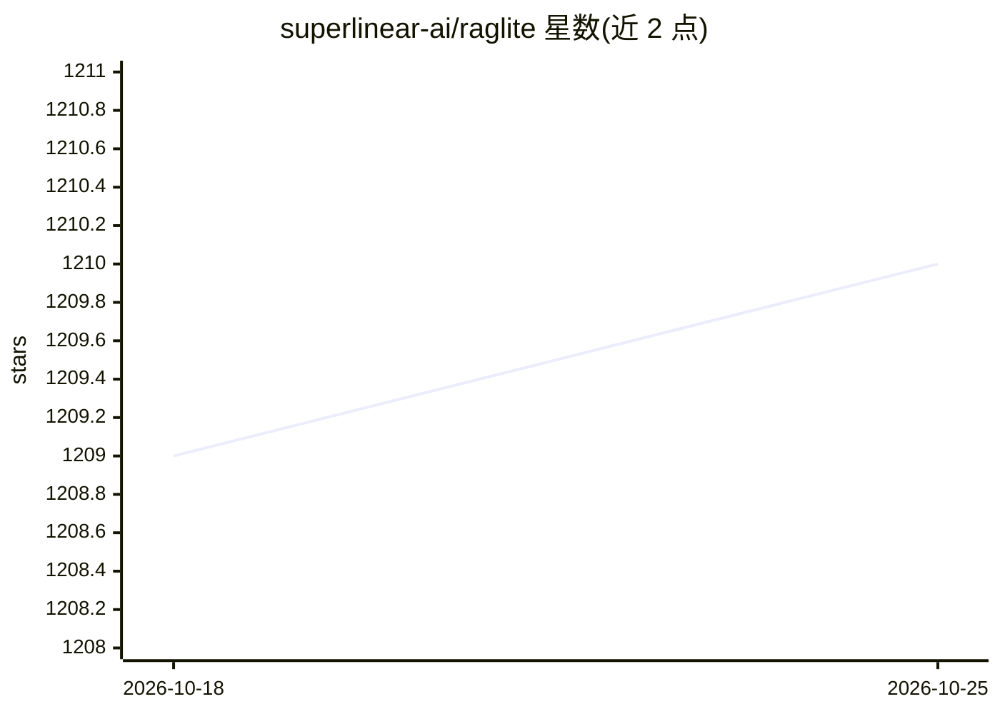

# superlinear-ai/raglite

⭐ 1,210 · Python · MPL-2.0 · 推送 2026-10-16 · [GitHub](https://github.com/superlinear-ai/raglite) · 组织维护

**Python RAG 工具包：DuckDB/PostgreSQL 上的检索增强生成**

RAGLite 是一个用于检索增强生成的 Python 工具包，面向开发者。通过 LiteLLM 接入任意 LLM 提供商（含 llama-cpp-python 本地模型），支持 DuckDB 或 PostgreSQL 作为关键词与向量混合检索数据库，默认使用 rerankers 重排（FlashRank）。提供 PDF 转 Markdown、late chunking 多向量嵌入、最优语义分块、自适应检索、闭式查询适配器、Ragas 评测、MCP 服务器与 Chainlit 前端。依赖均为轻量宽松开源组件，不含 PyTorch 或 LangChain。

## 筛选速览

| 维度 | 判定 | 备注 |
|---|---|---|
| AI 角色 | `ai-ecosystem` | LLM/agent 周边工具 |
| 许可风险 | `permissive` | MPL-2.0 |
| 部署形态 | `library` | 以包/库形式分发 |
| 模型依赖 | local-ok | 支持本地模型 |
| 硬件要求 | — | 无带数字的原话,不猜 |
| 安装摩擦 | `medium` | 含编译或系统依赖之一 |
| 成熟度 | — | 结构信号不足 |

## 能力要点

- DuckDB/PostgreSQL 原生混合检索（FTS+VSS；tsvector+pgvector）
- LLM 自主决定是否及检索什么内容的自适应 RAG
- 通过求解正交 Procrustes 问题计算最优闭式查询适配器
- 内置 MCP 服务器与可选 Chainlit 前端

## 适用场景

- 构建基于自有文档的问答系统
- 用本地 llama.cpp 模型搭建无外部依赖的 RAG 流水线
- 为 Claude desktop 等 MCP 客户端提供知识库检索工具
- 评测并优化 RAG 检索与生成质量

## 场景标签

`RAG` · 领域:知识与检索

## 证据(README 行号)

> L5: RAGLite is a Python toolkit for Retrieval-Augmented Generation (RAG) with DuckDB or PostgreSQL.
> L105: First, configure RAGLite with your preferred DuckDB or PostgreSQL database and any LLM supported by LiteLLM:

## 星数曲线

2026-10-18 1,209 → 2026-10-25 1,210（+1）

---
*卡片 v1 · prompt 1.4 · 生成 2026-10-21 · 置信度 high · 依据 README sha `3377b7ef1731` · [字段定义](../../DATASET.md)*
