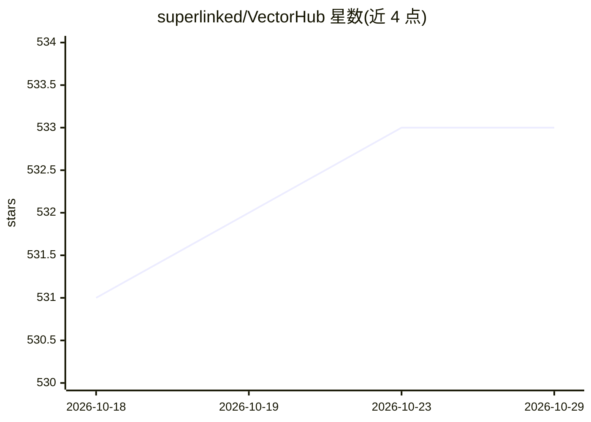

# superlinked/VectorHub

⭐ 533 · Jupyter Notebook · NOASSERTION · 推送 2026-10-26 · [GitHub](https://github.com/superlinked/VectorHub) · [官网](https://superlinked.com/examples/) · 组织维护

**向量检索学习资源库：帮助开发者入门向量检索与选型**

面向希望在 ML 技术栈中加入向量检索的开发者的开源学习中心（CC BY-NC-SA 4.0 许可），提供教程与实操资料，覆盖从构建 MVP、解决具体向量检索场景问题、走向生产环境，到了解并选择向量数据库厂商。附带开源工具 Vector DB Comparison，用于对比各向量数据库的功能集，功能均经过不同程度验证。仓库已声明 Deprecated，维护方 Superlinked 现转向开发自托管推理引擎 SIE。

## 筛选速览

| 维度 | 判定 | 备注 |
|---|---|---|
| AI 角色 | `ai-knowledge` | 知识聚合/清单类 |
| 许可风险 | `none` | NOASSERTION |
| 部署形态 | `None` |  |
| 模型依赖 | — | README 未给出锁定关系 |
| 硬件要求 | — | 无带数字的原话,不猜 |
| 安装摩擦 | `low` | 无编译、无系统依赖或容器化 |
| 成熟度 | — | 结构信号不足 |

## 能力要点

- 向量检索入门与 MVP 构建的学习资料
- 面向生产化的实操指南
- Vector DB Comparison 向量数据库功能对比工具

## 适用场景

- 学习如何给 ML 技术栈添加向量检索
- 对比不同向量数据库的功能集
- 了解向量检索领域厂商并选型

## 场景标签

`教程课程` `精选清单` · 领域:学习与行业

## 证据(README 行号)

> L5: VectorHub is a free and open-sourced learning hub for people interested in adding vector retrieval to their ML stack
> L15: Vector DB Comparison is a free and open source tool from VectorHub to compare vector databases. It is created to ou

## 星数曲线

2026-10-18 531 → 2026-10-29 533（+2）

---
*卡片 v1 · prompt 1.4 · 生成 2026-10-21 · 置信度 high · 依据 README sha `be5238c963d6` · [字段定义](../../DATASET.md)*
