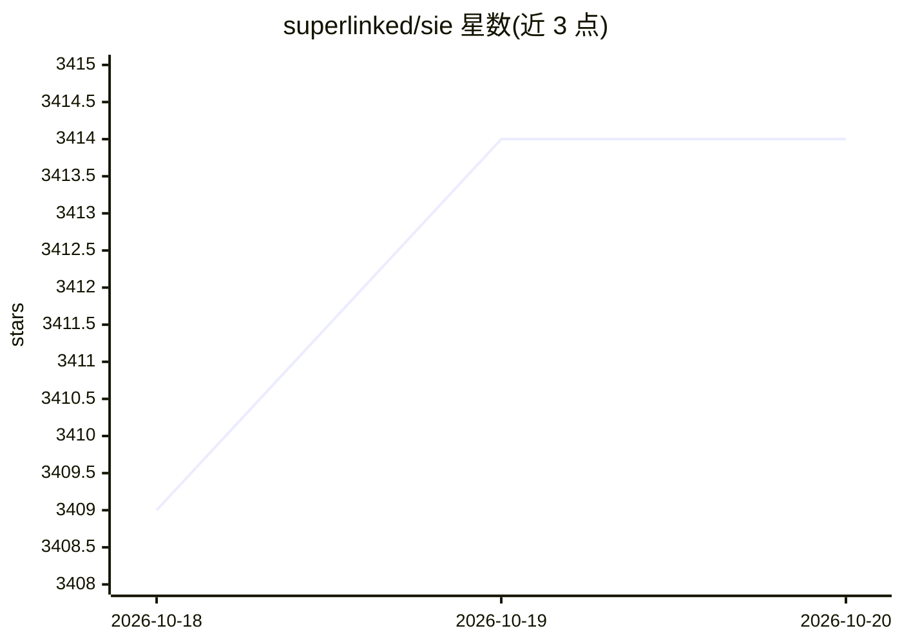

# superlinked/sie

⭐ 3,414 · Python · Apache-2.0 · 推送 2026-10-19 · [GitHub](https://github.com/superlinked/sie) · [官网](https://superlinked.com) · 组织维护

**自托管推理引擎：用一套 OpenAI 兼容 API 运行 agent 所需的 100+ 开源模型**

Superlinked 开源的推理服务器与生产集群：以单一 API 服务 agent 各环节的模型调用——检索/重排、文档转 markdown、结构化抽取、内容安全、agent 循环、翻译、视觉与语音转录，模型目录含 Stella、SPLADE、Qwen3、GLiNER 等 100+ 个，按需加载并 LRU 逐出。提供 OpenAI 兼容端点，配套 Python/TypeScript SDK、Docker 镜像、Kubernetes/Helm 部署与 KEDA 缩容到零。macOS Apple Silicon 与 Linux 可本地 pip 运行，文本生成需 GPU 镜像；遥测在 0.13.0 前默认开启。整体 Apache 2.0。

## 筛选速览

| 维度 | 判定 | 备注 |
|---|---|---|
| AI 角色 | `ai-ecosystem` | LLM/agent 周边工具 |
| 许可风险 | `permissive` | Apache-2.0 |
| 部署形态 | `self-host` | docker 或自建部署 |
| 模型依赖 | — | README 未给出锁定关系 |
| 硬件要求 | — | 无带数字的原话,不猜 |
| 安装摩擦 | `low` | 无编译、无系统依赖或容器化 |
| 成熟度 | — | 结构信号不足 |

## 能力要点

- OpenAI 兼容 API（/v1/embeddings、/v1/chat/completions 等）
- 预配置 100+ 模型目录，多模型并发、按需加载与 LRU 逐出
- Kubernetes/Helm 部署、KEDA 自动伸缩与 Grafana 面板
- 与 LangChain、LlamaIndex、Haystack、DSPy、CrewAI 及 Chroma/Qdrant/Weaviate/LanceDB 集成

## 适用场景

- 在自有云中统一托管 agent 全链路的模型推理
- 以 OpenAI 兼容接口替换分散的多模型服务
- 为向量库与 RAG 框架提供本地 embedding 与重排服务

## 场景标签

`推理引擎` · 领域:训练与推理

## 证据(README 行号)

> L26: SIE is an open-source inference engine that runs the models behind every agent task through one API: search and ret
> L31: - Ships Kubernetes and Helm deployment configs for the load-balancing gateway, KEDA autoscaling, and Grafana dashbo

## 星数曲线

2026-10-18 3,409 → 2026-10-20 3,414（+5）

---
*卡片 v1 · prompt 1.4 · 生成 2026-10-20 · 置信度 mid · 依据 README sha `c0b0e3f443f7` · [字段定义](../../DATASET.md)*
