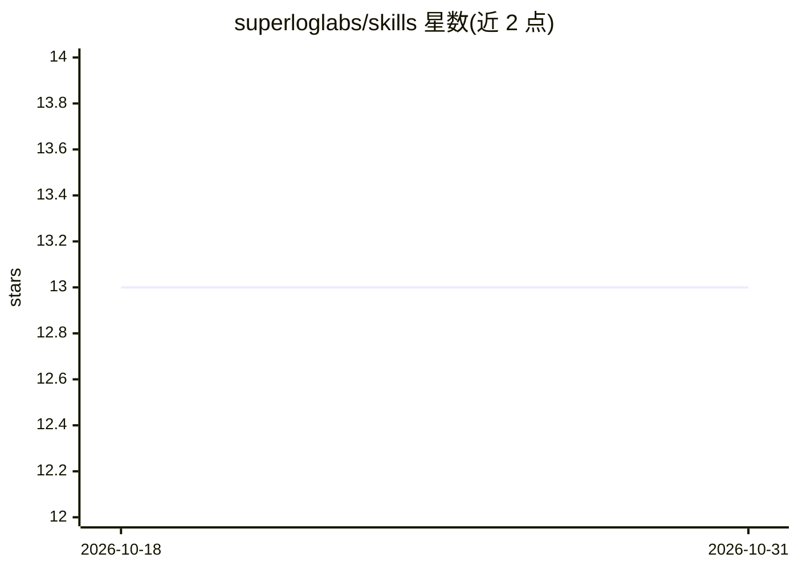

# superloglabs/skills

⭐ 13 · HTML · Apache-2.0 · 推送 2026-06-04 · [GitHub](https://github.com/superloglabs/skills) · [官网](https://superlog.sh) · 组织维护

**Agent 技能包：一条提示词为项目接入 Superlog 可观测性**

superloglabs 维护的 agent 技能集合，包含主技能 superlog-onboard 与多个 otel-*-style 技能：让 agent 通过自然语言指令为仓库内各应用安装 Superlog 可观测性、为单个功能/接口/任务添加 OTel spans、metrics 与 logs，以及通过 Superlog MCP 拉取生产遥测数据排查问题。风格类技能覆盖 Python、FastAPI、Flask、Next.js、LiveKit、Expo、Supabase Edge 等语言与框架，未覆盖语言走通用回退技能。通过 npx skills add 安装。

## 筛选速览

| 维度 | 判定 | 备注 |
|---|---|---|
| AI 角色 | `ai-ecosystem` | LLM/agent 周边工具 |
| 许可风险 | `permissive` | Apache-2.0 |
| 部署形态 | `library` | 以包/库形式分发 |
| 模型依赖 | — | README 未给出锁定关系 |
| 硬件要求 | — | 无带数字的原话,不猜 |
| 安装摩擦 | `low` | 无编译、无系统依赖或容器化 |
| 成熟度 | — | 结构信号不足 |

## 能力要点

- superlog-onboard 为仓库内全部可运行应用安装 Superlog 可观测性
- 按语言/框架提供 OpenTelemetry 风格指导（Python/FastAPI/Flask/Next.js 等）
- superlog-debug 经 Superlog MCP 拉取生产遥测排查问题
- npx skills add 一条命令安装，支持全量或单个技能

## 适用场景

- 让 coding agent 一条提示词为项目接入 Superlog 与 OpenTelemetry
- 为新功能/接口编写时就地添加 OTel 埋点
- 排查生产环境问题与线上行为回归

## 场景标签

`LLM 可观测性` · 领域:评测与运维

## 证据(README 行号)

> L3: Agent skills for onboarding projects to Superlog with native OpenTelemetry traces, logs, and metrics.
> L21: - `superlog-onboard` - install Superlog observability across every runnable app and service in a repo.

## 星数曲线

2026-10-18 13 → 2026-10-31 13（+0）

---
*卡片 v1 · prompt 1.4 · 生成 2026-10-31 · 置信度 high · 依据 README sha `4a670afca55f` · [字段定义](../../DATASET.md)*
