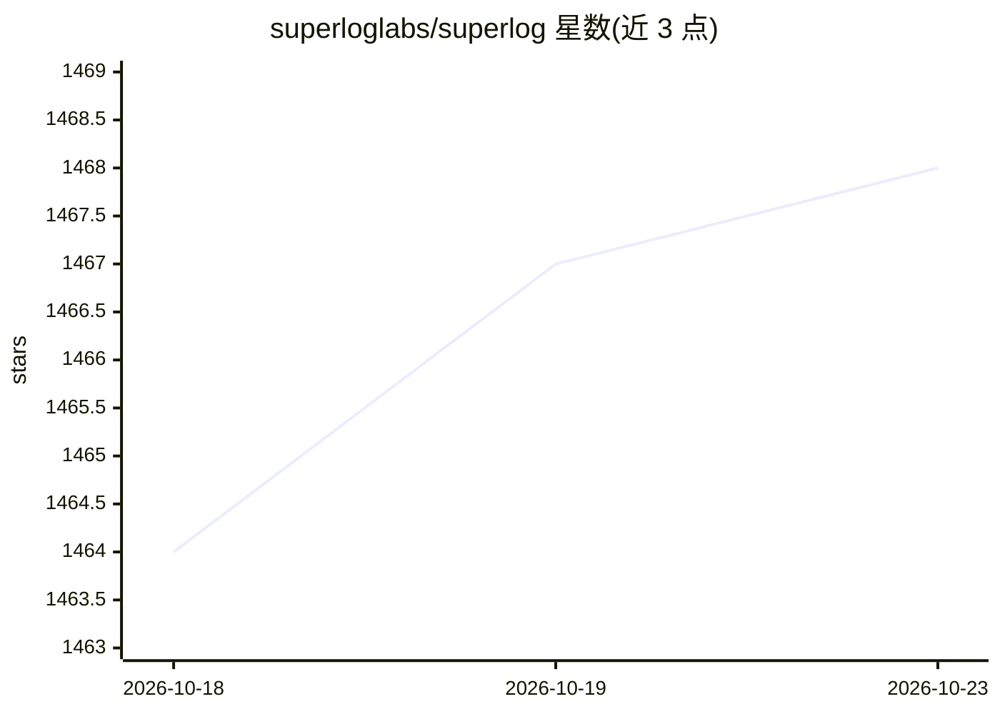

# superloglabs/superlog

⭐ 1,468 · TypeScript · Apache-2.0 · 推送 2026-10-22 · [GitHub](https://github.com/superloglabs/superlog) · [官网](https://superlog.sh) · 组织维护

**开源 agentic 遥测系统：接入 OTel 数据并用 AI agent 分组诊断事件**

自托管的可观测性工作台：通过 OTLP 摄入代理接收 traces/logs/metrics，基于 Postgres 与 ClickHouse 存储，将噪声信号分组为事件（incidents），并提供 Web 界面与 API 供团队调试生产系统。仓库包含开源社区版（Web、API、worker、可插拔 agent runner 与默认 community runner），另有托管云版含免费层。本地运行需 Node.js 20+、pnpm 9+ 与 Docker，经 pnpm 与 docker compose 启动；也可通过 npx skills 在编码 agent 中安装。

## 筛选速览

| 维度 | 判定 | 备注 |
|---|---|---|
| AI 角色 | `ai-enhanced` | 去掉 AI 部分产品仍成立 |
| 许可风险 | `permissive` | Apache-2.0 |
| 部署形态 | `self-host` | docker 或自建部署 |
| 模型依赖 | — | README 未给出锁定关系 |
| 硬件要求 | — | 无带数字的原话,不猜 |
| 安装摩擦 | `low` | 无编译、无系统依赖或容器化 |
| 成熟度 | — | 结构信号不足 |

## 能力要点

- OTLP 摄入 traces/logs/metrics，ClickHouse 支撑遥测查询
- 噪声信号自动分组为事件（incidents）
- 可插拔 agent runner 接口与默认 community 事件摘要 runner
- 包含开源社区版，另有含免费层的托管云版

## 适用场景

- 团队自托管调试生产系统的可观测性平台
- 把 traces/logs/metrics 聚合为事件进行排查
- 让 AI agent 在本地运行时对事件做调查记录

## 场景标签

 · 领域:开发工具/可观测性

## 证据(README 行号)

> L27: Superlog is an open-source agentic telemetry system. It
> L40: Superlog is an open-core observability workspace for OpenTelemetry data. It
> L50: - Agent runner interfaces for pluggable investigation runtimes

## 星数曲线

2026-10-18 1,464 → 2026-10-23 1,468（+4）

---
*卡片 v1 · prompt 1.4 · 生成 2026-10-21 · 置信度 high · 依据 README sha `79a1ec5f0f0f` · [字段定义](../../DATASET.md)*
