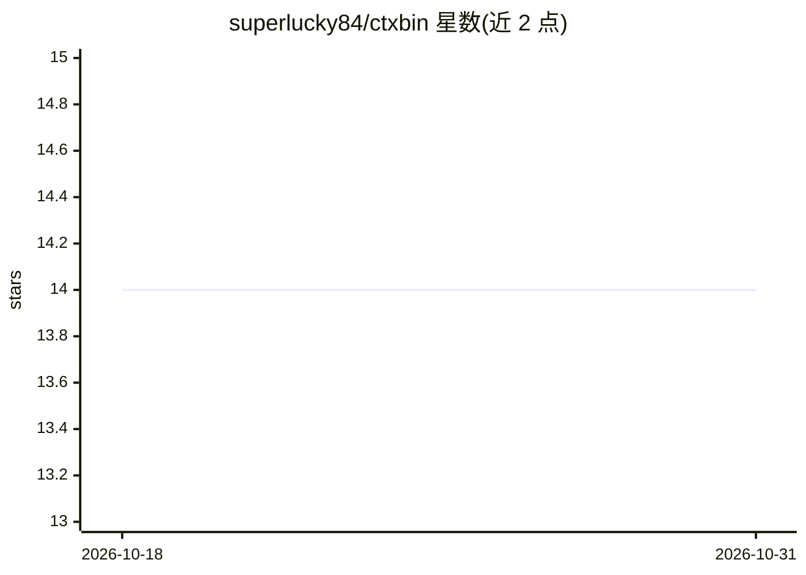

# superlucky84/ctxbin

⭐ 14 · JavaScript · MIT · 推送 2026-10-14 · [GitHub](https://github.com/superlucky84/ctxbin) · [官网](https://superlucky84.github.io/ctxbin/) · 个人维护

**用 Upstash Redis 存取 AI agent 上下文/技能/规则的 CLI**

TypeScript 编写的命令行工具，把分支级上下文（ctx）、agent 角色与 skill 存入 Upstash Redis 哈希，供多个 AI 编码 agent 在同一仓库/分支间做交接；在 git 仓库内自动按仓库+分支推断键名。skill 支持纯文本、tar.gz+Base64 目录包（skillpack）和 GitHub 目录引用（skillref）三种形式；sync 命令可将远端技能与 agent 安装到本地 Claude Code 或 Codex，支持 dry-run 预览、prune 清理、原子性替换与回滚，并带 backup/restore 的 JSON 导出导入。硬性前提：需自建 Upstash Redis 数据库并配置 REST URL/token。通过 npx 免安装运行或 pnpm 全局安装。

## 筛选速览

| 维度 | 判定 | 备注 |
|---|---|---|
| AI 角色 | `ai-ecosystem` | LLM/agent 周边工具 |
| 许可风险 | `permissive` | MIT |
| 部署形态 | `library` | 以包/库形式分发 |
| 模型依赖 | — | README 未给出锁定关系 |
| 硬件要求 | — | 无带数字的原话,不猜 |
| 安装摩擦 | `low` | 无编译、无系统依赖或容器化 |
| 成熟度 | — | 结构信号不足 |

## 能力要点

- 分支作用域 ctx 键，git 仓库内自动推断
- skill 三种存储形式：字符串 / skillpack 目录包 / skillref GitHub 引用
- sync 将远端技能与 agent 安装到 Claude Code 与 Codex，含 dry-run、prune、回滚与安装跟踪（.ctxbin-sync.json）
- backup/restore 导出全部 skill/agent 键值到版本化 JSON（不含凭据）

## 适用场景

- 多个 AI agent 在同一仓库/分支间交接工作时保存与加载上下文
- 把团队共享的技能与 agent 规则集中存储并安装到本地 Claude Code/Codex
- 对已安装的远端技能做备份与恢复

## 场景标签

`Agent 记忆` · 领域:Agent 开发

## 证据(README 行号)

> L3: Minimal, deterministic CLI to save and load **context**, **agents**, and **skills** in Upstash Redis hashes,
> L5: It is designed for fast handoff between AI agents working on the same repo/branch,

## 星数曲线

2026-10-18 14 → 2026-10-31 14（+0）

---
*卡片 v1 · prompt 1.4 · 生成 2026-10-31 · 置信度 high · 依据 README sha `bae31b5ad86b` · [字段定义](../../DATASET.md)*
