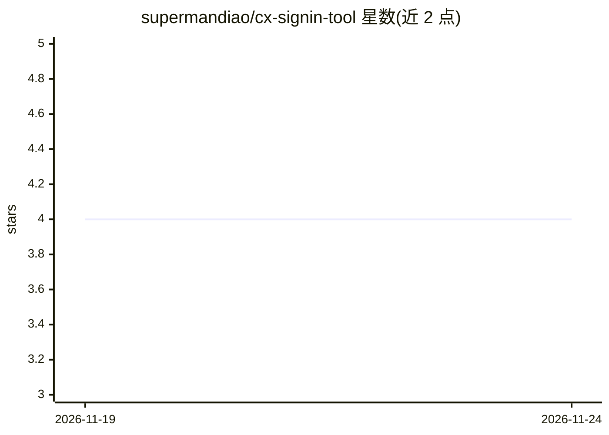

# supermandiao/cx-signin-tool

⭐ 4 · 推送 2026-11-17 · [GitHub](https://github.com/supermandiao/cx-signin-tool) · 个人维护 · 中文 README

**学习通外挂：自动签到与 AI 填作业的 Android 工具**

独立 Android App，通过 WebView 复用系统学习通的登录态，提供普通/位置/签到码签到的全自动处理，以及手势、二维码、拍照签到的半自动流程；作业与考试部分调用用户自填的 DeepSeek API Key，对单选、多选、填空、判断、简答、程序题进行自动作答与提交。免 root，仓库只分发 APK、不含源码。README 明确声明使用属于学术不端，存在被平台风控识别的风险，需用户自行承担后果。

## 筛选速览

| 维度 | 判定 | 备注 |
|---|---|---|
| AI 角色 | `ai-native` | 本体是模型或模型工具 |
| 许可风险 | `none` | — |
| 部署形态 | `None` |  |
| 模型依赖 | locked-api |  |
| 硬件要求 | — | 无带数字的原话,不猜 |
| 安装摩擦 | `low` | 无编译、无系统依赖或容器化 |
| 成熟度 | — | 结构信号不足 |

## 能力要点

- 普通/位置/签到码签到全自动，位置签到可测距反解目标点
- 调用 DeepSeek 自动作答 6 类题型并提交，兼容 OpenAI 接口格式的其他模型
- 免 root，独立 App 共用系统学习通登录态
- API Key 本机存储，代码无硬编码 Key

## 适用场景

- 自动完成学习通各类签到任务
- 用 AI 生成作业与考试题答案后人工检查再提交
- 在无 root 的普通 Android 手机上运行

## 场景标签

`GUI 自动化` · 领域:效率与自动化

## 证据(README 行号)

> L16: > **不是修改版学习通，是外挂工具**：独立 App，靠 WebView 加载你自己的学习通登录态，再调 DeepSeek 帮你点签到、填作业。**学习通官方不受影响、也与此无关。**
> L60: **作业**：填 AI 设置（接口 `https://api.deepseek.com/v1`、模型 `deepseek-chat`、你自己的 `sk-...`）→ 点「检测连通」出现「通了（xxx ms）」→ 进作业页 → 点「

## 星数曲线

2026-11-19 4 → 2026-11-24 4（+0）

---
*卡片 v1 · prompt 1.4 · 生成 2026-11-21 · 置信度 high · 依据 README sha `08319a53834f` · [字段定义](../../DATASET.md)*
