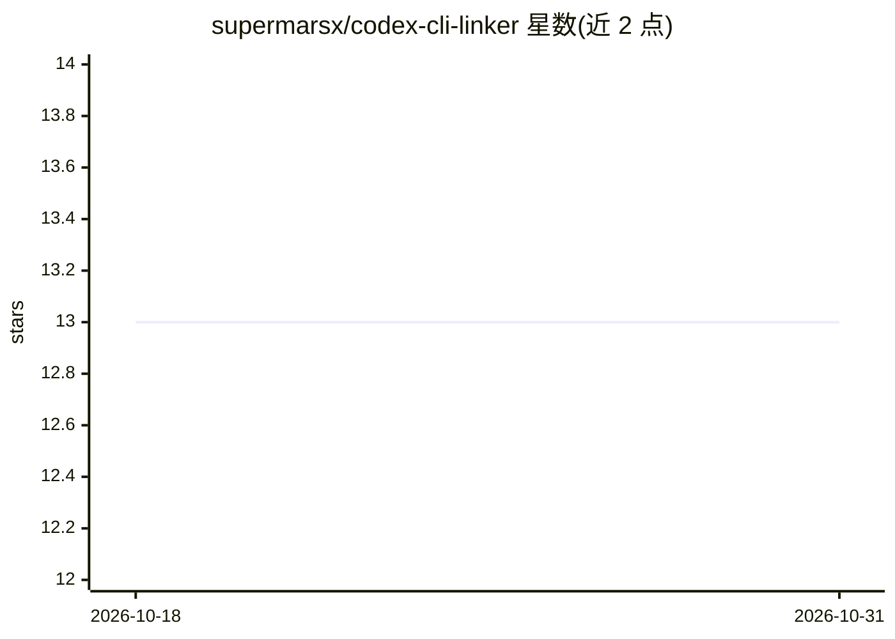

# supermarsx/codex-cli-linker

⭐ 13 · Python · MIT · 推送 2026-01-18 · [GitHub](https://github.com/supermarsx/codex-cli-linker) · 个人维护

**为 Codex CLI 生成接入 LM Studio/Ollama 等本地模型的配置文件**

单文件、无第三方依赖的 Python 脚本，面向使用 OpenAI Codex CLI 的开发者：自动探测本地 OpenAI 兼容服务器（LM Studio :1234、Ollama :11434，亦支持 vLLM、Text-Gen-WebUI 等），从 /v1/models 拉取模型列表供选择，然后生成符合 Codex schema 的 ~/.codex/config.toml（可选 JSON/YAML），写前自动备份，并在 linker_config.json 记住上次选择。支持 OpenAI 官方 API 两种鉴权模式、MCP 服务器与 profile 交互管理、OS 钥匙串存 API key。提供 PyPI/Homebrew/Scoop/独立可执行文件多种安装途径。工具本身不调用模型，只查询本地服务器接口。

## 筛选速览

| 维度 | 判定 | 备注 |
|---|---|---|
| AI 角色 | `ai-ecosystem` | LLM/agent 周边工具 |
| 许可风险 | `permissive` | MIT |
| 部署形态 | `desktop` | 安装包/桌面程序 |
| 模型依赖 | local-ok | 支持本地模型 |
| 硬件要求 | — | 无带数字的原话,不猜 |
| 安装摩擦 | `low` | 无编译、无系统依赖或容器化 |
| 成熟度 | — | 结构信号不足 |

## 能力要点

- 自动探测 LM Studio/Ollama 等本地 OpenAI 兼容服务器并归一化 base URL
- 生成 Codex schema 的 config.toml（可选 JSON/YAML），写前备份
- 不写 API key 到磁盘，可选 OS 钥匙串（Keychain/DPAPI/Secret Service 等）存储
- 支持 --dry-run 预览、--auto/--full-auto 非交互流程

## 适用场景

- 让 Codex CLI 使用 LM Studio 或 Ollama 跑的本地模型
- 快速生成并管理多个 Codex 配置 profile
- 为 Codex 配置 MCP 服务器条目
- 切换 Codex 到 OpenAI 官方 API 鉴权

## 场景标签

 · 领域:LLM 基础设施/开发工具

## 证据(README 行号)

> L3: Generate a ready‑to‑run **Codex CLI** configuration for OpenAI‑compatible servers like **LM Studio**, **Ollama**, an
> L47: - Auto-detects local OpenAI-compatible servers (LM Studio, Ollama, vLLM, Text‑Gen‑WebUI OpenAI plugin, TGI shim, Op
> L251: > The tool itself does **not** talk to OpenAI; it only queries your local server’s `/v1/models` to list model IDs.

## 星数曲线

2026-10-18 13 → 2026-10-31 13（+0）

---
*卡片 v1 · prompt 1.4 · 生成 2026-10-31 · 置信度 mid · 依据 README sha `28d9e7f056ad` · [字段定义](../../DATASET.md)*
