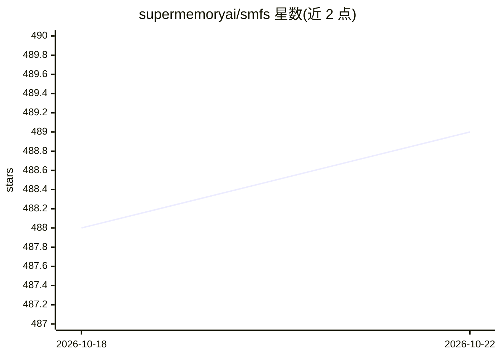

# supermemoryai/smfs

⭐ 489 · Rust · MIT · 推送 2026-10-02 · [GitHub](https://github.com/supermemoryai/smfs) · [官网](https://smfs.ai) · 组织维护

**把 Supermemory 记忆容器挂载为本地文件系统的 CLI 工具**

由 Supermemory 团队维护的 Rust 编写命令行工具：将 Supermemory 容器以 FUSE/NFS 挂载为真实本地目录，可用编辑器、cat、grep 等常规文件操作读写，写操作后台上传、远端变更每 30 秒拉取。挂载内无参数 grep 自动路由到语义检索索引，另有 @supermemory/bash TypeScript 包为无本地文件系统的运行时（Cloudflare Workers、边缘运行时等）提供虚拟 bash 工具。需要 Supermemory API key，支持 macOS 与 Linux 的 arm64/x64。

## 筛选速览

| 维度 | 判定 | 备注 |
|---|---|---|
| AI 角色 | `ai-ecosystem` | LLM/agent 周边工具 |
| 许可风险 | `permissive` | MIT |
| 部署形态 | `self-host` | docker 或自建部署 |
| 模型依赖 | — | README 未给出锁定关系 |
| 硬件要求 | — | 无带数字的原话,不猜 |
| 安装摩擦 | `low` | 无编译、无系统依赖或容器化 |
| 成熟度 | — | 结构信号不足 |

## 能力要点

- 将 Supermemory 容器挂载为本地目录（FUSE/NFS 后端）
- 挂载内无参数 grep 自动走语义检索索引
- @supermemory/bash 包为无文件系统运行时提供 run_bash 工具与 sgrep 语义搜索
- --memory-paths 指定哪些路径进入记忆生成流水线

## 适用场景

- 让 agent 用熟悉的 Unix 命令和 grep 读写记忆容器
- 在编辑器中直接查看和修改 agent 记忆文件
- 在 Cloudflare Workers/边缘运行时给 agent 提供文件系统与语义搜索工具

## 场景标签

 · 领域:AI agent 基础设施

## 证据(README 行号)

> L5: Your Supermemory container, exposed as a filesystem. Read, write, and `grep` your memory like any local directory.
> L95: A TypeScript package (`@supermemory/bash`) for AI agents running where there is no local filesystem to mount onto: 

## 星数曲线

2026-10-18 488 → 2026-10-22 489（+1）

---
*卡片 v1 · prompt 1.4 · 生成 2026-10-21 · 置信度 high · 依据 README sha `71a04aa87897` · [字段定义](../../DATASET.md)*
