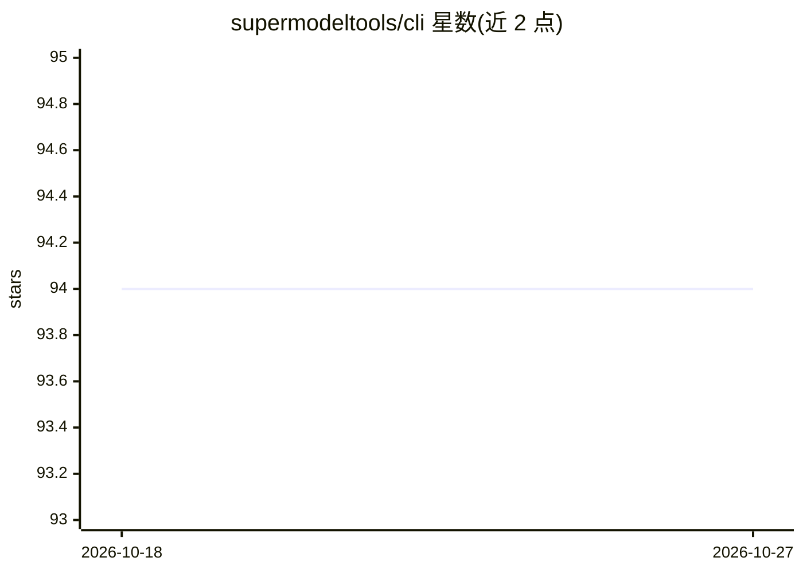

# supermodeltools/cli

⭐ 94 · Go · MIT · 推送 2026-07-20 · [GitHub](https://github.com/supermodeltools/cli) · [官网](https://supermodeltools.com/trial) · 组织维护

**为 AI 编程 agent 生成代码图谱文件以降低 token 成本的 CLI**

Supermodel CLI 将仓库上传至 Supermodel API 构建完整调用图，在每个源文件旁写入纯文本 .graph.* 分片（含 deps/calls/impact 段），任何能读文件的 agent（Claude Code、Cursor、Copilot、Windsurf、Aider）通过 grep/cat 自动读取，无需 agent 侧配置。另提供死代码检测、影响面分析、代码压缩、MCP server（暴露 analyze/dead_code/blast_radius/get_graph 工具）与 Claude Code PostToolUse hook 实时更新。分析依赖云端 API，需 Supermodel 账号认证。

## 筛选速览

| 维度 | 判定 | 备注 |
|---|---|---|
| AI 角色 | `ai-ecosystem` | LLM/agent 周边工具 |
| 许可风险 | `permissive` | MIT |
| 部署形态 | `library` | 以包/库形式分发 |
| 模型依赖 | — | README 未给出锁定关系 |
| 硬件要求 | — | 无带数字的原话,不猜 |
| 安装摩擦 | `low` | 无编译、无系统依赖或容器化 |
| 成熟度 | — | 结构信号不足 |

## 能力要点

- 每个源文件旁写入纯文本 .graph.* 分片，agent 经 grep/cat 自动读取
- 提供 dead-code、blast-radius、audit、focus 等按需分析命令
- 内建 stdio MCP server，向 Claude Code 等 MCP 宿主暴露图工具
- Claude Code PostToolUse hook 支持文件变更实时增量更新

## 适用场景

- 让编程 agent 在改代码前了解依赖、调用关系与影响面
- 检测仓库中不可达函数与循环依赖
- 降低 agent 阅读大型代码库的 token 消耗

## 场景标签

 · 领域:开发工具/代码分析

## 证据(README 行号)

> L5: Supermodel maps every file, function, and call relationship in your repo and writes a `.graph` file next to each sou
> L31: `.graph` files are plain text. Any agent that can read files — Claude Code, Cursor, Copilot, Windsurf — picks them 
> L146: |`mcp`|Start a stdio MCP server exposing graph tools to Claude Code and other MCP hosts|

## 星数曲线

2026-10-18 94 → 2026-10-27 94（+0）

---
*卡片 v1 · prompt 1.4 · 生成 2026-10-23 · 置信度 high · 依据 README sha `b62048242998` · [字段定义](../../DATASET.md)*
