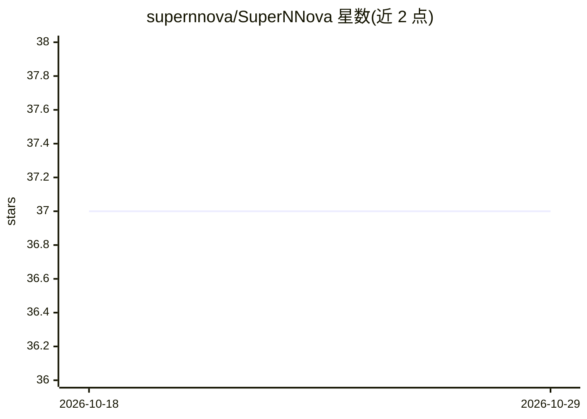

# supernnova/SuperNNova

⭐ 37 · Python · MIT · 推送 2026-08-17 · [GitHub](https://github.com/supernnova/SuperNNova) · 组织维护

**天体物理研究者用的超新星测光时序分类深度学习框架**

SuperNNova 是开源的光度时序分类框架，面向超新星巡天数据分析的天体物理研究者。提供 LSTM、GRU、贝叶斯 RNN 等多种循环神经网络架构，支持二分类与多分类，可读取 csv 与 SNANA FITS 格式的模拟数据进行训练，是 PIPPIN 宇宙学端到端流水线的组成部分。以 pip 包发布，也可克隆仓库开发；论文复现需切换到特定分支或 commit（如 paper 分支、SNANA_DES5yr 分支）。

## 筛选速览

| 维度 | 判定 | 备注 |
|---|---|---|
| AI 角色 | `ai-native` | 本体是模型或模型工具 |
| 许可风险 | `permissive` | MIT |
| 部署形态 | `library` | 以包/库形式分发 |
| 模型依赖 | — | README 未给出锁定关系 |
| 硬件要求 | — | 无带数字的原话,不猜 |
| 安装摩擦 | `low` | 无编译、无系统依赖或容器化 |
| 成熟度 | — | 结构信号不足 |

## 能力要点

- 多种 RNN 架构：LSTM、GRU、贝叶斯 RNN
- 支持 csv 与 SNANA FITS 格式训练数据
- 支持二分类与多分类的光度时序分类
- 作为 PIPPIN 宇宙学流水线的组成部分

## 适用场景

- 训练自定义超新星测光时序分类模型
- 复现 DES 巡天分析或 MNRAS 论文结果
- 接入宇宙学端到端流水线做瞬变源分类

## 场景标签

 · 领域:天体物理/时序分类

## 证据(README 行号)

> L15: SuperNNova is an open-source photometric time-series classification framework.
> L17: The framework includes different RNN architectures (LSTM, GRU, Bayesian RNNs) and can be trained with simulations i

## 星数曲线

2026-10-18 37 → 2026-10-29 37（+0）

---
*卡片 v1 · prompt 1.4 · 生成 2026-10-25 · 置信度 high · 依据 README sha `8ced4700c2f9` · [字段定义](../../DATASET.md)*
