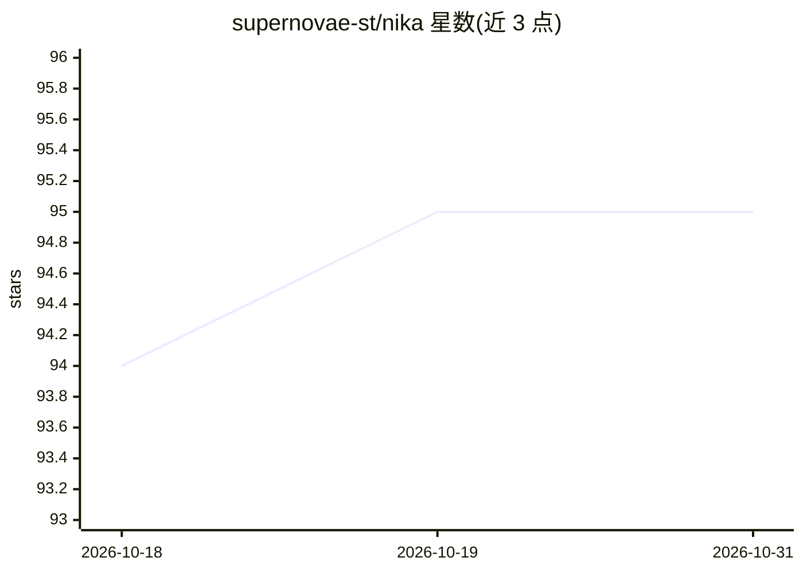

# supernovae-st/nika

⭐ 95 · Rust · AGPL-3.0 · 推送 2026-10-28 · [GitHub](https://github.com/supernovae-st/nika) · [官网](https://nika.sh) · 组织维护

**把重复 AI 工作写成可检查工作流文件的 Rust CLI 工具**

Nika 以单个 Rust 二进制与 `.nika` 工作流文件为核心：用自然语言描述任务后生成工作流文件，`nika check` 在不调用模型的情况下静态审计其行为、权限与成本上限，`nika run` 按用户选择的模型（本地或云端）执行，`nika trace verify` 校验哈希链运行记录。支持人工审批门、预算拒绝、并行步骤与回退步骤，并提供 VSCode 插件、GitHub Action 与 TypeScript 客户端。声明 pre-1.0，Windows 需经 WSL2 使用，Session 仅在六项合成任务上做过资格验证。

## 筛选速览

| 维度 | 判定 | 备注 |
|---|---|---|
| AI 角色 | `ai-ecosystem` | LLM/agent 周边工具 |
| 许可风险 | `viral` | AGPL-3.0 |
| 部署形态 | `library` | 以包/库形式分发 |
| 模型依赖 | local-ok | 支持本地模型 |
| 硬件要求 | — | 无带数字的原话,不猜 |
| 安装摩擦 | `low` | 无编译、无系统依赖或容器化 |
| 成熟度 | `idea` | |

## 能力要点

- nika check 在调用模型前静态审计工作流的行为、可触达范围与成本上限
- 每次运行留下哈希链记录，`nika trace verify` 可定位篡改位置
- 支持本地与云端模型：Ollama、llama.cpp、LM Studio、vLLM 及 API 供应商
- 提供 VSCode 插件、GitHub Action、TypeScript 客户端与编码 agent 插件

## 适用场景

- 把每周重复的 AI 任务（如提取会议行动项）保存为可复跑的工作流文件
- 在 CI 中对 PR 工作流执行检查并在超预算时拒绝运行
- 要求人工审批后才执行写入或发布类步骤

## 场景标签

`工作流自动化` · 领域:效率与自动化

## 证据(README 行号)

> L35: Nika turns repeatable AI work into a small file you keep. Say what you
> L203: (Ollama, llama.cpp, LM Studio, vLLM) work too: `nika catalog` lists them.

## 星数曲线

2026-10-18 94 → 2026-10-31 95（+1）

---
*卡片 v1 · prompt 1.4 · 生成 2026-10-23 · 置信度 high · 依据 README sha `10b682d02b03` · [字段定义](../../DATASET.md)*
