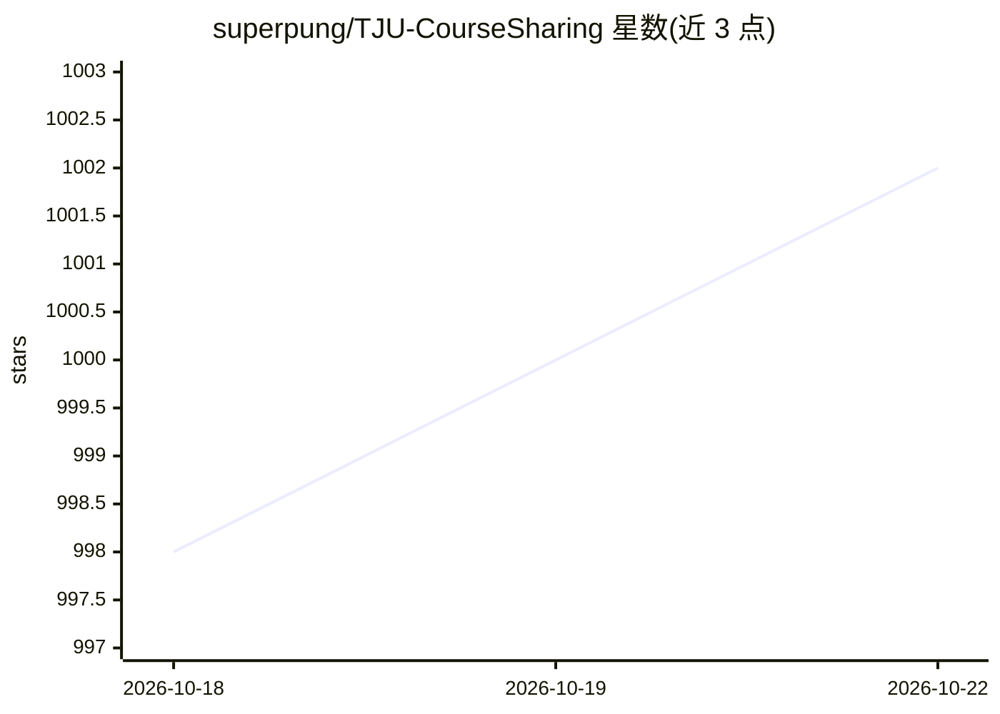

# superpung/TJU-CourseSharing

⭐ 1,005 · Tcl · CC-BY-SA-4.0 · 推送 2026-10-03 · [GitHub](https://github.com/superpung/TJU-CourseSharing) · [官网](https://cs.tjuse.com) · 个人维护 · 中文 README

**天津大学课程资料共享仓库：选课攻略与历年试卷**

由个人发起、依托 GitHub 仓库组织的天津大学课程资料共享计划，受浙江大学课程攻略共享计划启发。按课程目录收录选课攻略 README、电子版教材、课件、平时作业与实验、历年试卷及复习资料，通过 Issue 和 Pull Request 接受贡献，另提供网页版 cs.tjuse.com。使用方式为浏览器快捷键搜索文件、Octotree 扩展浏览，或经 DownGit、GitZip 下载单个文件夹。内容以文档资料为主，无软件构建过程。

## 筛选速览

| 维度 | 判定 | 备注 |
|---|---|---|
| AI 角色 | `ai-knowledge` | 知识聚合/清单类 |
| 许可风险 | `viral` | CC-BY-SA-4.0 |
| 部署形态 | `None` |  |
| 模型依赖 | — | README 未给出锁定关系 |
| 硬件要求 | — | 无带数字的原话,不猜 |
| 安装摩擦 | `low` | 无编译、无系统依赖或容器化 |
| 成熟度 | — | 结构信号不足 |

## 能力要点

- 收录选课攻略、教材、课件、作业、历年试卷、复习资料等类别
- 基于 GitHub 目录组织，每门课可附 README 说明
- 通过 Issue/PR 协作贡献，提供网页版 cs.tjuse.com

## 适用场景

- 查找天大某门课的历年试卷和复习资料
- 选课前查看前人的选课攻略与经验分享
- 将自己整理的课程资料贡献给共享计划

## 场景标签

 · 领域:教育/课程资料

## 证据(README 行号)

> L44: - [x] 选课攻略：`README.md`
> L56: - [x] 网页，请访问 cs.tjuse.com

## 星数曲线

2026-10-18 998 → 2026-10-22 1,002（+4）

---
*卡片 v1 · prompt 1.4 · 生成 2026-10-21 · 置信度 mid · 依据 README sha `40b54d00f606` · [字段定义](../../DATASET.md)*
