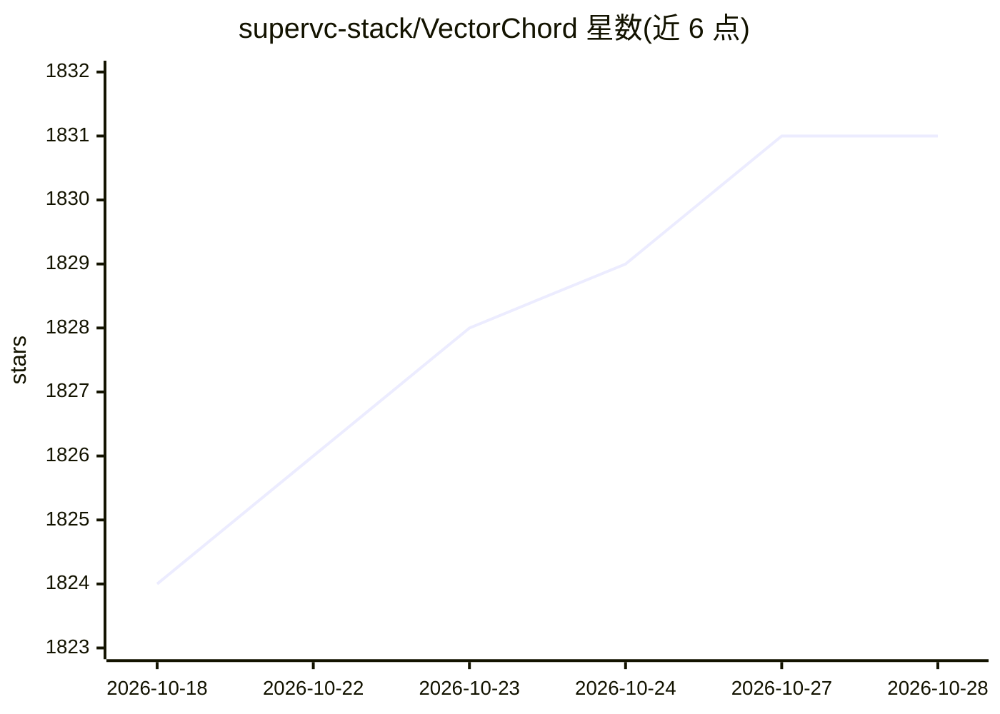

# supervc-stack/VectorChord

⭐ 1,831 · Rust · NOASSERTION · 推送 2026-08-06 · [GitHub](https://github.com/supervc-stack/VectorChord) · [官网](https://docs.vectorchord.ai/vectorchord/getting-started/overview.html) · 组织维护

**PostgreSQL 向量检索扩展，支持十亿级向量的低成本存储与搜索**

TensorChord 维护的 PostgreSQL 扩展（vchord），是 pgvecto.rs 的后继项目。基于 RaBitQ 量化压缩与自动重排实现向量检索，提供 4-bit/8-bit 原生向量类型以降低存储成本；官方给出单机托管 1 亿向量的硬件参考（i4i.xlarge）并称可通过降维与采样扩展到 10 亿级。兼容 pgvector 的数据类型与语法，依赖 pgvector 作为扩展依赖。推荐 Docker 方式安装，SQL 层创建扩展与 vchordrq 索引后即可执行向量查询。项目采用双许可模型。

## 筛选速览

| 维度 | 判定 | 备注 |
|---|---|---|
| AI 角色 | `ai-ecosystem` | LLM/agent 周边工具 |
| 许可风险 | `none` | NOASSERTION |
| 部署形态 | `self-host` | docker 或自建部署 |
| 模型依赖 | — | README 未给出锁定关系 |
| 硬件要求 | — | 无带数字的原话,不猜 |
| 安装摩擦 | `low` | 无编译、无系统依赖或容器化 |
| 成熟度 | — | 结构信号不足 |

## 能力要点

- RaBitQ 量化压缩与自动重排，提供 4-bit/8-bit 向量类型
- 兼容 pgvector 数据类型与语法，CREATE EXTENSION CASCADE 安装
- 支持分层 K-means 索引构建，100M 向量索引 20 分钟（官方数据）
- 提供 Docker 镜像及含 bm25/tokenizer 的 suite 组合镜像

## 适用场景

- 在现有 PostgreSQL 中做大规模向量相似度检索
- RAG/LLM 应用的嵌入式向量存储
- 控制向量存储成本，复用 pgvector 语法迁移应用

## 场景标签

`向量数据库` · 领域:知识与检索

## 证据(README 行号)

> L18: VectorChord (vchord) is a PostgreSQL extension engineered for scalable, high-performance, and cost-effective vector
> L61: VectorChord depends on pgvector, including the vector representation. Since you can use them directly, your applica

## 星数曲线

2026-10-18 1,824 → 2026-10-28 1,831（+7）

---
*卡片 v1 · prompt 1.4 · 生成 2026-10-21 · 置信度 high · 依据 README sha `b31b40d42185` · [字段定义](../../DATASET.md)*
