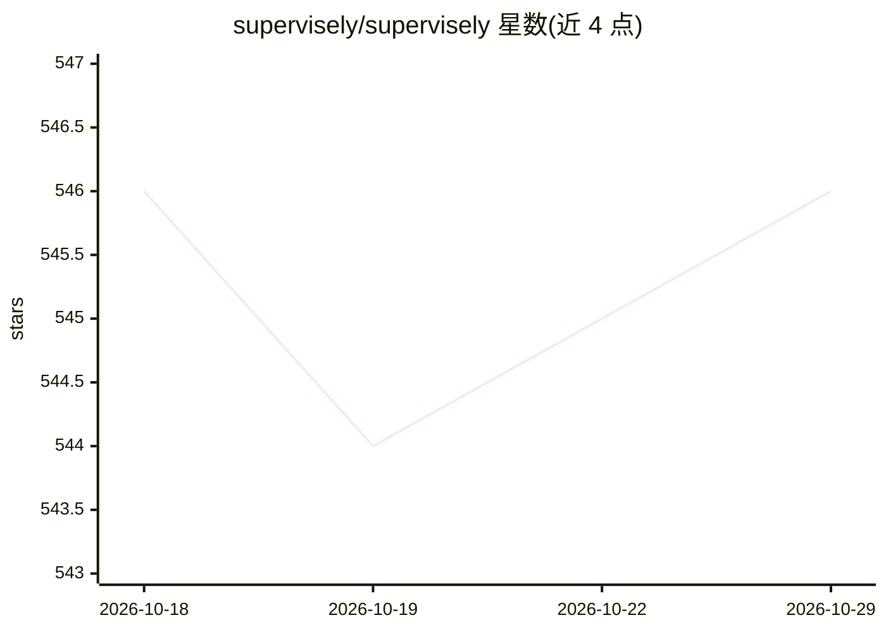

# supervisely/supervisely

⭐ 546 · Python · Apache-2.0 · 推送 2026-10-28 · [GitHub](https://github.com/supervisely/supervisely) · [官网](https://supervisely.com) · 组织维护

**计算机视觉平台的 Python SDK：自动化与扩展标注平台**

Supervisely 计算机视觉平台的官方 Python SDK，供开发者通过脚本、REST API 或应用扩展该平台。平台功能包括图像/视频/点云/医学影像标注、数据可视化与质量控制、模型训练与推理、AI 辅助标注、合成数据生成。SDK 封装 API 方法，支持导入导出数据、上传模型预测、构建无 UI 或带交互式 UI 的应用（数百个现成 UI 组件），基于 opencv/pytorch/fastapi 等库。通过 pip 安装，需连接 Supervisely 平台（社区版或企业自托管）使用。

## 筛选速览

| 维度 | 判定 | 备注 |
|---|---|---|
| AI 角色 | `ai-ecosystem` | LLM/agent 周边工具 |
| 许可风险 | `permissive` | Apache-2.0 |
| 部署形态 | `self-host` | docker 或自建部署 |
| 模型依赖 | — | README 未给出锁定关系 |
| 硬件要求 | — | 无带数字的原话,不猜 |
| 安装摩擦 | `low` | 无编译、无系统依赖或容器化 |
| 成熟度 | — | 结构信号不足 |

## 能力要点

- 封装平台 REST API，提供错误处理/重连/分页等机制
- 五级集成层级：REST API、Python 脚本、无头应用、交互式 UI 应用、标注工具内嵌应用
- 数百个现成交互式 UI 组件，无需前端经验
- 覆盖标注、数据管理、模型训练与 AI 辅助标注的完整工作流

## 适用场景

- 编写 Python 脚本自动化平台上的数据导入导出与标注任务
- 为团队构建带 Web UI 的自定义标注或模型训练应用
- 上传自有模型预测结果并集成到标注流程中

## 场景标签

 · 领域:计算机视觉/数据标注平台

## 证据(README 行号)

> L3: Computer Vision Platform,
> L112: Supervisely SDK for Python is specially designed to speed up development, reduce boilerplate, and lets you do anyt

## 星数曲线

2026-10-18 546 → 2026-10-29 546（+0）

---
*卡片 v1 · prompt 1.4 · 生成 2026-10-21 · 置信度 mid · 依据 README sha `d510d397d2da` · [字段定义](../../DATASET.md)*
