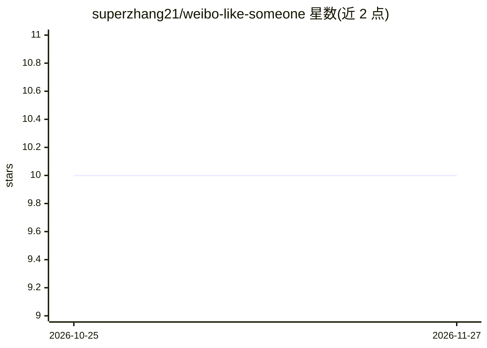

# superzhang21/weibo-like-someone

⭐ 10 · Python · MIT · 推送 2026-06-15 · [GitHub](https://github.com/superzhang21/weibo-like-someone) · 个人维护 · 中文 README

**给内容创作者与 Agent 用户：克隆微博博主发文风格生成内容**

基于 AI 的微博博主风格克隆工具：抓取公开博主微博，提取思维逻辑、微观语法、配图策略与负特征，再按该风格生成微博文本。提供两种模式：有 OPENAI_API_KEY 时走 API 生成；无 API 时运行 analyze 输出结构化语料，交由 Agent 自行解构与生成。含微博桌面版 AJAX 接口爬虫、SQLite 缓存（7 天特征有效期）、SKILL.md 定义以便 Agent 安装接管；使用需提供 weibo.com 登录 cookie。

## 筛选速览

| 维度 | 判定 | 备注 |
|---|---|---|
| AI 角色 | `ai-native` | 本体是模型或模型工具 |
| 许可风险 | `permissive` | MIT |
| 部署形态 | `library` | 以包/库形式分发 |
| 模型依赖 | — | README 未给出锁定关系 |
| 硬件要求 | — | 无带数字的原话,不猜 |
| 安装摩擦 | `low` | 无编译、无系统依赖或容器化 |
| 成熟度 | — | 结构信号不足 |

## 能力要点

- 深度风格克隆：提取思维逻辑、微观语法、配图策略与负特征
- API 模式与 Agent 协作模式双路径（无 LLM API 时输出结构化语料）
- 内置 SQLite 缓存，特征 7 天有效期
- SKILL.md 定义，供 Agent 自动安装接管

## 适用场景

- 分析某微博博主的文风特征
- 让 Agent 模仿指定博主口吻写微博
- 批量抓取博主全文语料并过滤转发

## 场景标签

`网页抓取` `AI 写作` · 领域:效率与自动化

## 证据(README 行号)

> L9: `Weibo Like Someone` 是一个基于 AI 的微博博主风格克隆工具。它可以深度解构任何公开博主的语言特征（思维逻辑、微观语法、配图策略、负特征等），并支持在 **自动化（LLM）** 和 **Agent 协作（人工智
> L19:  * **API 模式**：如果你有 `OPENAI_API_KEY`，直接运行 `cli.py`。
> L20:  * **本地推理模式**：如果没有 API，运行 `cli.py --action analyze`，程序会将结构化语料输出到终端，请你直接根据输出进行风格解构与内容生成。

## 星数曲线

2026-10-25 10 → 2026-11-27 10（+0）

---
*卡片 v1 · prompt 1.4 · 生成 2026-11-19 · 置信度 high · 依据 README sha `2a2fea761930` · [字段定义](../../DATASET.md)*
