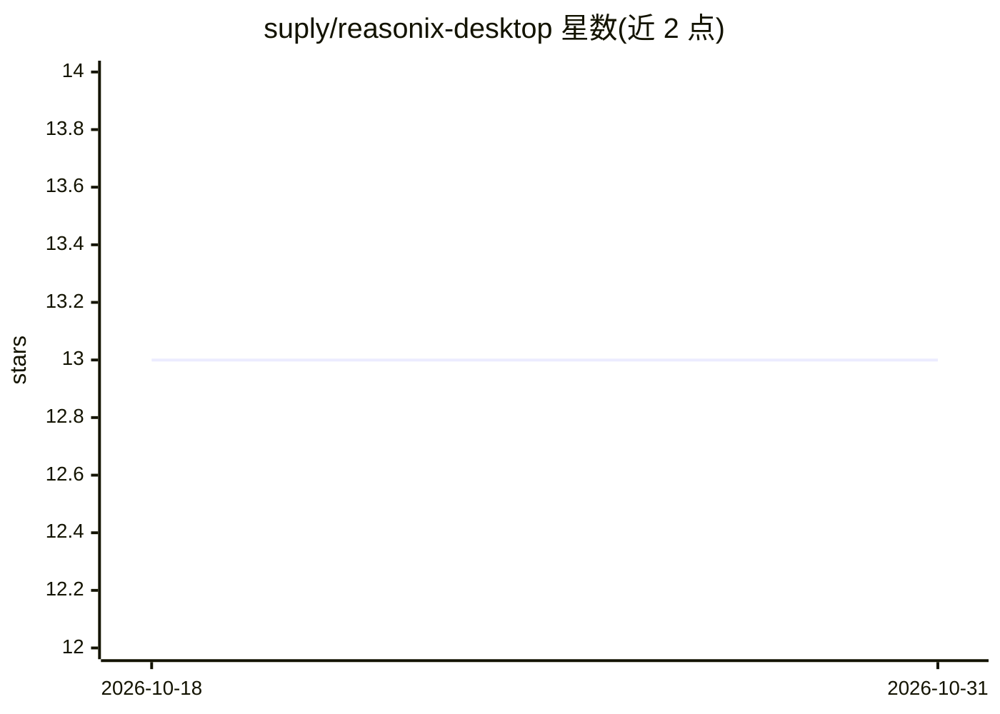

# suply/reasonix-desktop

⭐ 13 · Vue · MIT · 推送 2026-05-22 · [GitHub](https://github.com/suply/reasonix-desktop) · 个人维护 · 中文 README

**Reasonix agentic 编码框架的 Electron+Vue 3 桌面客户端**

从原 Tauri + React 版本移植到 Electron 38 + Vue 3 + Element Plus 的桌面客户端，通过 stdin/stdout JSON-line RPC 协议将 Reasonix CLI 作为子进程管理。功能包括流式 AI 对话、工作区管理、会话历史、MCP 服务器配置、技能面板调用、模型预设切换、Review/Auto/Yolo 编辑模式与主题系统。面向使用 Reasonix（DeepSeek 原生的 agentic 编码框架）的开发者，需 Node ≥ 22 从源码构建运行。

## 筛选速览

| 维度 | 判定 | 备注 |
|---|---|---|
| AI 角色 | `ai-ecosystem` | LLM/agent 周边工具 |
| 许可风险 | `permissive` | MIT |
| 部署形态 | `library` | 以包/库形式分发 |
| 模型依赖 | — | README 未给出锁定关系 |
| 硬件要求 | — | 无带数字的原话,不猜 |
| 安装摩擦 | `low` | 无编译、无系统依赖或容器化 |
| 成熟度 | — | 结构信号不足 |

## 能力要点

- 通过 JSON-line RPC 协议管理 Reasonix CLI 子进程
- MCP 服务器配置与已安装技能浏览/调用
- Review / Auto / Yolo 三档文件变更审批模式
- 模型预设（auto/flash/pro）快速切换与会话历史管理

## 适用场景

- 在桌面图形界面中使用 Reasonix 进行 agentic 编码
- 管理和切换工作区与历史会话
- 配置 MCP 服务器并浏览调用技能

## 场景标签

`编码 Agent` · 领域:编码与开发

## 证据(README 行号)

> L5: An **Electron** desktop client for Reasonix — the DeepSeek-native agentic coding framework. This is a port of the or
> L25: - **RPC Subprocess** — Spawns the Reasonix CLI as a managed child process with stdin/stdout JSON-line protocol

## 星数曲线

2026-10-18 13 → 2026-10-31 13（+0）

---
*卡片 v1 · prompt 1.4 · 生成 2026-10-31 · 置信度 mid · 依据 README sha `b7262b4ecf40` · [字段定义](../../DATASET.md)*
