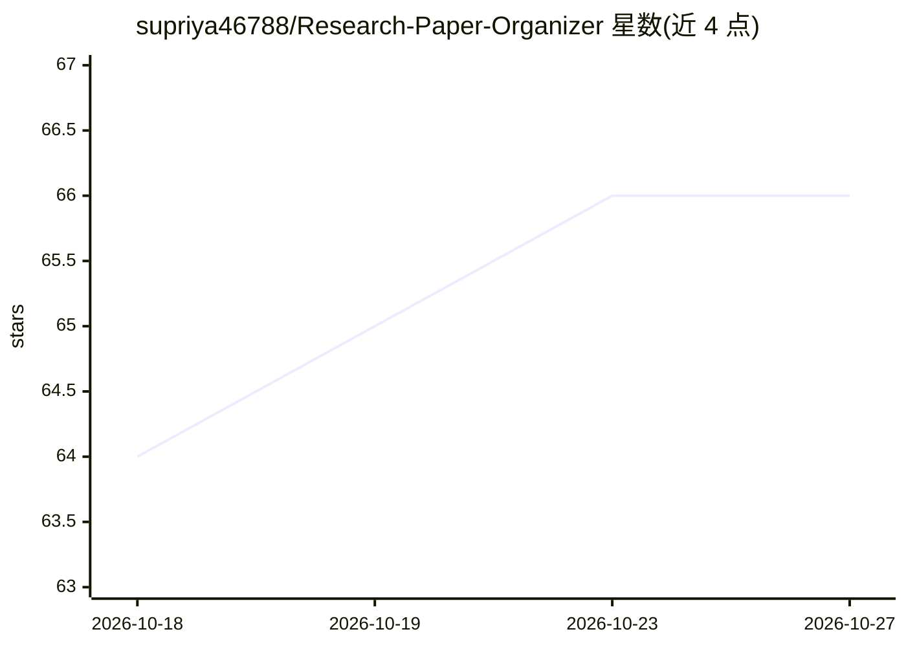

# supriya46788/Research-Paper-Organizer

⭐ 66 · HTML · MIT · 推送 2026-05-18 · [GitHub](https://github.com/supriya46788/Research-Paper-Organizer) · [官网](https://supriya46788.github.io/Research-Paper-Organizer/) · 个人维护

**静态网页版研究论文管理工具：添加、分类、检索文献卡片**

用纯 HTML/CSS/JavaScript 构建的静态单页应用，供学生、研究者与专业人士集中录入研究论文条目，支持按类别（AI、ML、Web 等）排序过滤、搜索与可视化卡片展示，不依赖框架。使用方式为克隆仓库后直接用浏览器打开 index.html；另有 Python 3.8+ 后端脚本与 npm 前端依赖作为运行前提。项目为 GSSoC'25 开源计划的一部分，云端同步、AI 自动分类、PDF 标注等功能尚在规划中。

## 筛选速览

| 维度 | 判定 | 备注 |
|---|---|---|
| AI 角色 | `ai-enhanced` | 去掉 AI 部分产品仍成立 |
| 许可风险 | `permissive` | MIT |
| 部署形态 | `None` |  |
| 模型依赖 | — | README 未给出锁定关系 |
| 硬件要求 | — | 无带数字的原话,不猜 |
| 安装摩擦 | `low` | 无编译、无系统依赖或容器化 |
| 成熟度 | — | 结构信号不足 |

## 能力要点

- 静态 SPA，纯 HTML/CSS/JavaScript 实现，无框架依赖
- 论文条目录入、分类过滤、搜索与卡片展示
- GSSoC'25 官方项目，面向开源贡献者
- AI 分类、PDF 标注、Google Scholar/Zotero 集成列为规划功能

## 适用场景

- 集中记录和分类管理自己收集的研究论文
- 按类别快速筛选和查找论文条目
- 开源新手通过 GSSoC 参与前端项目贡献

## 场景标签

`科研工具` · 领域:学习与行业

## 证据(README 行号)

> L5: A clean, minimal, and static web-based tool built using **HTML, CSS, and JavaScript** to help students, researchers,
> L29: - 🎯 Static single-page application (SPA) with smooth UI
> L109: - **AI-based categorization** for auto-tagging papers.

## 星数曲线

2026-10-18 64 → 2026-10-27 66（+2）

---
*卡片 v1 · prompt 1.4 · 生成 2026-10-24 · 置信度 low · 依据 README sha `61d3da99f6f0` · [字段定义](../../DATASET.md)*
