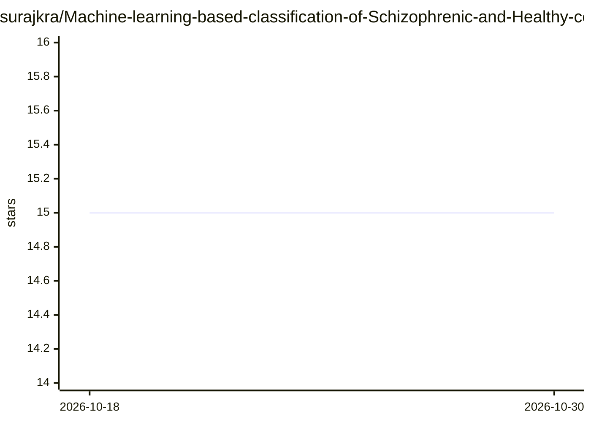

# surajkra/Machine-learning-based-classification-of-Schizophrenic-and-Healthy-control-Using-Resting-State-fMRI

⭐ 15 · Python · 推送 2026-05-11 · [GitHub](https://github.com/surajkra/Machine-learning-based-classification-of-Schizophrenic-and-Healthy-control-Using-Resting-State-fMRI) · [官网](https://sites.google.com/site/surajkiran1996raman/projects-1/automatic-classification-of-schizophrenic-healthy-controls-using-resting-state-network-fmri) · 个人维护

**本科毕业论文：用机器学习分析静息态fMRI自动分类精神分裂症**

一项本科毕业论文研究项目：基于静息态 fMRI 数据自动分类精神分裂症患者与健康对照。流程为：MATLAB SPM-12 预处理 DICOM 转 NIfTI，FSL Melodic ICA 生成时空矩阵；通过偏度过滤、K-means 聚类、周期图低频功率筛选自动识别静息态网络；提取功能网络连接（FNC）与自连接（AC）特征，用 SVM 与多层神经网络在 81 例样本上分类。README 为论文说明文档，未给出本仓库的安装或运行命令。

## 筛选速览

| 维度 | 判定 | 备注 |
|---|---|---|
| AI 角色 | `ai-native` | 本体是模型或模型工具 |
| 许可风险 | `none` | — |
| 部署形态 | `None` |  |
| 模型依赖 | — | README 未给出锁定关系 |
| 硬件要求 | — | 无带数字的原话,不猜 |
| 安装摩擦 | `low` | 无编译、无系统依赖或容器化 |
| 成熟度 | — | 结构信号不足 |

## 能力要点

- 自动静息态网络识别：偏度过滤+K-means聚类+周期图低频功率筛选，替代人工目视检查
- 从 100 个独立成分中自动选出 15 个显著网络成分
- 提取 FNC 与 AC 组合特征，使用 SVM 与神经网络（10-500 隐藏神经元）分类
- 数据集为 40 例精神分裂症与 41 例健康对照的静息态 fMRI

## 适用场景

- 了解静息态fMRI精神分裂症自动分类的完整研究流程
- 参考静息态网络自动识别方法（替代人工目视筛选）
- 复现或学习医学影像特征提取与分类实验

## 场景标签

 · 领域:医学影像/神经科学计算

## 证据(README 行号)

> L4: To create an Automated classifier capable of classifying subjects with Schizophrenia from Healthy control using Rest
> L13: Raw fMRI data were pre-processed using the Statistical Parametric Mapping toolbox (SPM-12) in MATLAB. The following
> L50: Support Vector Machine

## 星数曲线

2026-10-18 15 → 2026-10-30 15（+0）

---
*卡片 v1 · prompt 1.4 · 生成 2026-10-30 · 置信度 high · 依据 README sha `75dcc5bbb6cf` · [字段定义](../../DATASET.md)*
