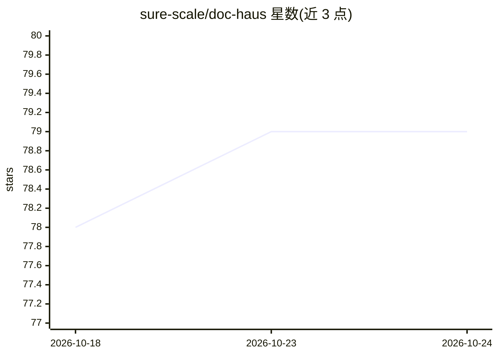

# sure-scale/doc-haus

⭐ 79 · TypeScript · GPL-3.0 · 推送 2026-10-23 · [GitHub](https://github.com/sure-scale/doc-haus) · [官网](https://doc.haus) · 组织维护

**本地自托管的法律文档 AI 助手：文档留在本地、红线稿输出为 Word 修订**

基于 OpenCode 分叉的本地法律文档工作区：用户将文档上传到 matter 中，向 AI 提出基于来源引用的问题，生成草稿与红线修订稿（以 Word 跟踪修订形式交付），供律师复核；README 明确声明生成内容需专业人员审查。文档与凭据保存在本地磁盘，引擎、摄取与 Web 服务分别运行在本地端口，仅 Web 端口发布。通过 start.sh 启动器安装依赖，亦提供 docker compose 本地容器方式；容器配置为本地自托管，对外网或团队托管需另行设计部署。

## 筛选速览

| 维度 | 判定 | 备注 |
|---|---|---|
| AI 角色 | `ai-native` | 本体是模型或模型工具 |
| 许可风险 | `viral` | GPL-3.0 |
| 部署形态 | `self-host` | docker 或自建部署 |
| 模型依赖 | — | README 未给出锁定关系 |
| 硬件要求 | — | 无带数字的原话,不猜 |
| 安装摩擦 | `low` | 无编译、无系统依赖或容器化 |
| 成熟度 | — | 结构信号不足 |

## 能力要点

- 文档留在本地磁盘，红线稿以 Word 跟踪修订形式输出
- 基于来源引用的问题回答与草稿、红线稿生成
- start.sh 启动器检测并安装 Bun 及文档工具链（Deno 2、Python、markitdown、Poppler、Tesseract、LibreOffice 等）
- 提供 docker compose 本地容器配置，仅 Web 端口发布于 host loopback

## 适用场景

- 律师在本地对案卷文档做基于来源的问答检索
- 生成合同草稿与红线修订稿供专业人员复核
- 对文档隐私有要求、需自托管的法律事务所文档处理

## 场景标签

`AI 助手` · 领域:对话与助手

## 证据(README 行号)

> L3: A local legal-document workspace built on OpenCode.
> L4: Upload documents into matters, ask source-grounded questions, and prepare drafts
> L5: and redlines for lawyer review. Generated work requires professional review.

## 星数曲线

2026-10-18 78 → 2026-10-24 79（+1）

---
*卡片 v1 · prompt 1.4 · 生成 2026-10-24 · 置信度 high · 依据 README sha `9bd055f5d67c` · [字段定义](../../DATASET.md)*
