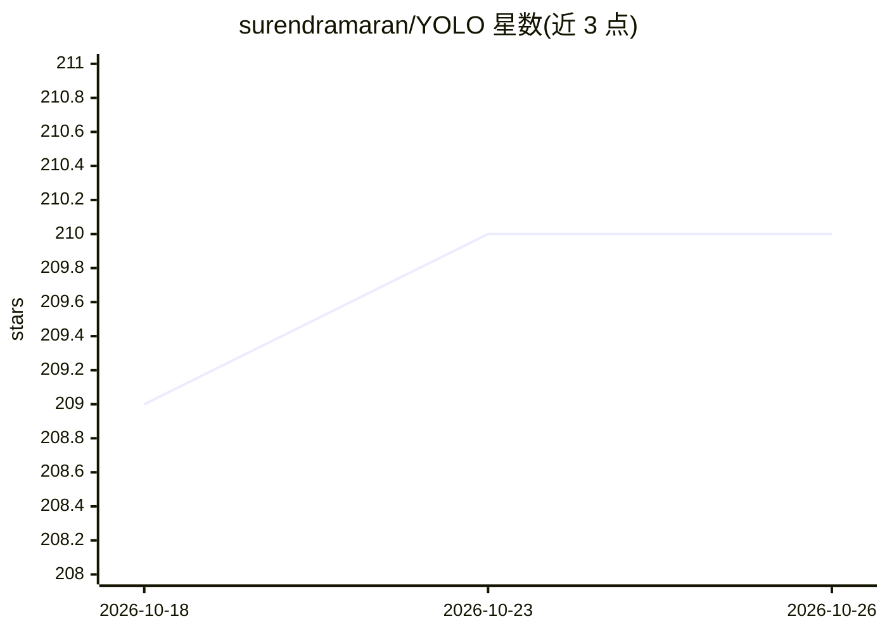

# surendramaran/YOLO

⭐ 210 · Kotlin · NOASSERTION · 推送 2026-05-18 · [GitHub](https://github.com/surendramaran/YOLO) · [官网](https://www.surendramaran.com/) · 个人维护

**在 Android 与 iOS 应用中集成 YOLO 模型的示例仓库**

提供将机器学习模型集成到移动应用的示例与实现，覆盖 YOLOv8 至 YOLOv11 系列模型，Android 侧使用 Kotlin，iOS 侧使用 SwiftUI。面向需要在移动端运行目标检测、图像分割、实例分割等任务的开发者，代码以仓库形式提供，供参考与复用。README 本身信息较少，具体安装与运行步骤需查看仓库内各平台目录。

## 筛选速览

| 维度 | 判定 | 备注 |
|---|---|---|
| AI 角色 | `ai-ecosystem` | LLM/agent 周边工具 |
| 许可风险 | `none` | NOASSERTION |
| 部署形态 | `None` |  |
| 模型依赖 | — | README 未给出锁定关系 |
| 硬件要求 | — | 无带数字的原话,不猜 |
| 安装摩擦 | `low` | 无编译、无系统依赖或容器化 |
| 成熟度 | — | 结构信号不足 |

## 能力要点

- 覆盖 YOLOv8/YOLOv9/YOLOv10/YOLOv11 的移动端集成示例
- Android 使用 Kotlin、iOS 使用 SwiftUI
- 主题涉及目标检测、图像分类、分割与 TFLite/CoreML

## 适用场景

- 在 Android 应用中运行 YOLO 目标检测模型
- 在 iOS 应用中以 CoreML 运行 YOLO 模型
- 参考 Kotlin/SwiftUI 代码实现移动端模型集成

## 场景标签

`目标检测` · 领域:感知与多模态

## 证据(README 行号)

> L3: Welcome to the **YOLO (You Only Look Once)** repository! This project focuses on integrating machine learning models

## 星数曲线

2026-10-18 209 → 2026-10-26 210（+1）

---
*卡片 v1 · prompt 1.4 · 生成 2026-10-22 · 置信度 low · 依据 README sha `afc41461f72c` · [字段定义](../../DATASET.md)*
