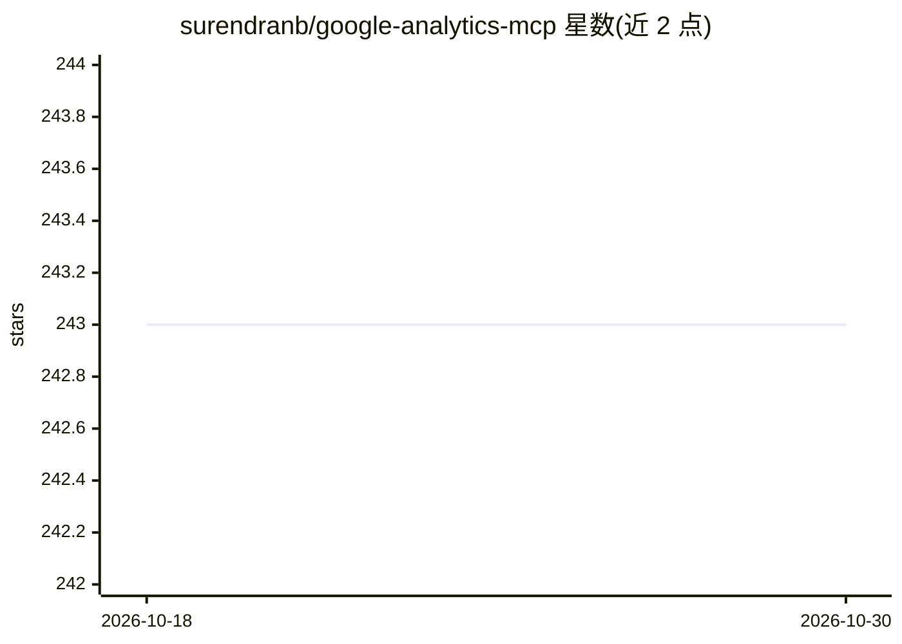

# surendranb/google-analytics-mcp

⭐ 243 · Python · MIT · 推送 2026-10-28 · [GitHub](https://github.com/surendranb/google-analytics-mcp) · [官网](https://ga4mcp.com) · 个人维护

**让 AI agent 查询 Google Analytics 4 数据的 MCP 服务器**

面向 AI agent、agentic workflow 与 MCP 客户端的 Google Analytics 4 数据服务器：提供多维报告查询、实时报告、账户与属性列表、维度/指标 schema 发现等 8 个工具，聚合在服务端完成并内置默认安全设置。附带从 GitHub 动态加载的分析技能（流量诊断、渠道归因、电商分析、AI 引荐流量分析）。支持 Claude Desktop/Code、Cursor、VS Code、Windsurf 等客户端配置，提供一行安装脚本与 uvx 运行方式；收集匿名遥测，可经环境变量退出。

## 筛选速览

| 维度 | 判定 | 备注 |
|---|---|---|
| AI 角色 | `ai-ecosystem` | LLM/agent 周边工具 |
| 许可风险 | `permissive` | MIT |
| 部署形态 | `library` | 以包/库形式分发 |
| 模型依赖 | locked-api |  |
| 硬件要求 | — | 无带数字的原话,不猜 |
| 安装摩擦 | `low` | 无编译、无系统依赖或容器化 |
| 成熟度 | — | 结构信号不足 |

## 能力要点

- 8 个工具：多维 GA4 报告、实时报告、schema 发现、账户/属性列表
- 从 GitHub 动态加载的分析技能与 playbook（流量诊断、渠道归因、电商漏斗等）
- 一键安装脚本自动配置 Claude Desktop、Cursor、VS Code 等客户端
- 服务端聚合与安全默认值，减少数据整理工作

## 适用场景

- 让 Claude/Cursor 等 MCP 客户端直接查询我的网站流量数据
- 用自然语言分析 GA4 的用户行为与转化漏斗
- 诊断流量骤降并按渠道做归因分析

## 场景标签

`数据分析` · 领域:效率与自动化

## 证据(README 行号)

> L5: > **Model Context Protocol (MCP) server for Google Analytics 4: real-time query exploration, schema discovery, metri
> L55: ## 🛠️ Tools & Capabilities

## 星数曲线

2026-10-18 243 → 2026-10-30 243（+0）

---
*卡片 v1 · prompt 1.4 · 生成 2026-10-22 · 置信度 high · 依据 README sha `a7a77bfcf185` · [字段定义](../../DATASET.md)*
