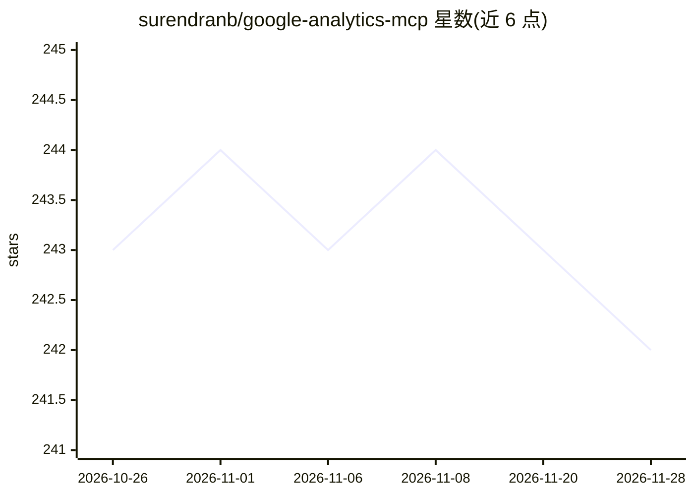

# surendranb/google-analytics-mcp

⭐ 242 · Python · MIT · 推送 2026-11-27 · [GitHub](https://github.com/surendranb/google-analytics-mcp) · [官网](https://ga4mcp.com) · 个人维护

**把 GA4 网站分析数据接入 AI agent 的 MCP 服务器**

面向 Google Analytics 4 的 MCP 服务器，为 AI agent 与 MCP 客户端提供网站流量、用户行为与效果数据的查询能力。提供 12 个工具：多维报表与服务器端聚合、属性列表、维度/指标 schema 发现与分类浏览、分析配方检索、故障排查指南、交互式修复配置与版本更新检查。内置流量诊断、渠道归因、电商转化、AI 引荐流量分析等动态技能。支持 Claude Code/Desktop、Cursor、VS Code 等客户端，默认开启脱敏遥测并可多途径退出。MIT 许可。

## 筛选速览

| 维度 | 判定 | 备注 |
|---|---|---|
| AI 角色 | `ai-ecosystem` | LLM/agent 周边工具 |
| 许可风险 | `permissive` | MIT |
| 部署形态 | `library` | 以包/库形式分发 |
| 模型依赖 | — | README 未给出锁定关系 |
| 硬件要求 | — | 无带数字的原话,不猜 |
| 安装摩擦 | `low` | 无编译、无系统依赖或容器化 |
| 成熟度 | — | 结构信号不足 |

## 能力要点

- get_ga4_data 多维报表，含服务端聚合、estimate_only 预估与大数据集保护开关
- search_schema 按关键词排序维度/指标，前置 schema 发现减少取数试错
- 内置分析配方与动态技能：流量骤降诊断、渠道归因、电商漏斗、AI 引荐流量隔离
- setup_ga4_access 无重启交互式修复配置，get_troubleshooting_guide 覆盖 setup/IAM/schema

## 适用场景

- 让 agent 直接查询网站流量与用户行为数据生成分析
- 排查 GA4 配置、IAM/403 权限与 schema 相关错误
- 追踪来自 ChatGPT、Claude 等的 AI 引荐流量
- 电商收入与转化漏斗的自动归因分析

## 场景标签

`数据分析` · 领域:效率与自动化

## 证据(README 行号)

> L5: > **Model Context Protocol (MCP) server for Google Analytics 4: real-time query exploration, schema discovery, metri
> L76: |`get_ga4_data`|`dimensions` (list), `metrics` (list), `date_range_start` (str), `date_range_end` (str), `dimension

## 星数曲线

2026-10-26 243 → 2026-11-28 242（-1）

---
*卡片 v1 · prompt 1.4 · 生成 2026-11-25 · 置信度 high · 依据 README sha `d55553398a3e` · [字段定义](../../DATASET.md)*
