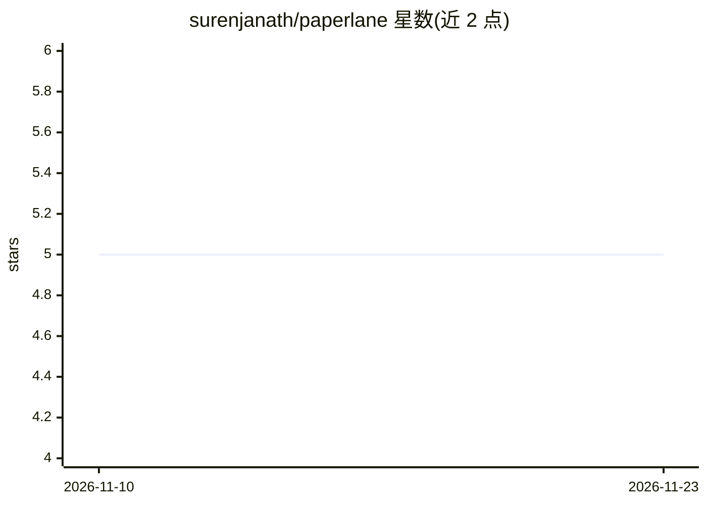

# surenjanath/paperlane

⭐ 5 · Python · AGPL-3.0 · 推送 2026-11-12 · [GitHub](https://github.com/surenjanath/paperlane) · [官网](https://paperlane.insightfusiontech.com) · 个人维护

**自托管 Django 文档工作流自动化：表单、审批与电子签名**

基于 Python/Django 的文档工作流自动化平台：可视化拖拽构建器、公共起始表单、电子签名、机器人步骤、分支泳道、定时自启动、团队工作队列、SLA、审计追踪与管理控制台。AI 部分支持本地 Ollama（自动发现模型）或云端（Claude、OpenAI 兼容服务器）引擎，并提供 MCP server 供 AI agent 调用。服务器端渲染模板、无前端构建步骤，SQLite 默认存储，附带约 350 个测试与演示数据种子脚本。

## 筛选速览

| 维度 | 判定 | 备注 |
|---|---|---|
| AI 角色 | `ai-enhanced` | 去掉 AI 部分产品仍成立 |
| 许可风险 | `viral` | AGPL-3.0 |
| 部署形态 | `library` | 以包/库形式分发 |
| 模型依赖 | local-ok | 支持本地模型 |
| 硬件要求 | — | 无带数字的原话,不猜 |
| 安装摩擦 | `low` | 无编译、无系统依赖或容器化 |
| 成熟度 | — | 结构信号不足 |

## 能力要点

- 可视化工作流构建器：分支泳道、条件跳转、多字段规则、undo/redo、蓝图导出
- 机器人步骤：预填（文档/工作流/CSV/表格/API）、邮件、短信、归档、证书等
- 本地 Ollama 自动发现模型，可切换 Claude 或任意 OpenAI 兼容服务器
- 公共起始表单带填表中机器人（查表预填，服务端二次校验）

## 适用场景

- 贷款、保险理赔等需要多步审批与签名的文档流程
- 用公共链接表单替代『网页表单→表格→流程』的人工链条
- 团队内部用工作队列与 SLA 跟踪文档流转

## 场景标签

`工作流自动化` · 领域:效率与自动化

## 证据(README 行号)

> L5: **Document-workflow automation**: visual workflow builder, drag-and-drop forms, e-signatures, bots, start forms,
> L6: team work queues, SLAs, AI (local Ollama or cloud) and a super admin console. It is built with Python and Django,
> L93: |`OLLAMA_HOST`|`http://127.0.0.1:11434`|Local AI models (auto-discovered). Each workspace can override it.|

## 星数曲线

2026-11-10 5 → 2026-11-23 5（+0）

---
*卡片 v1 · prompt 1.4 · 生成 2026-11-21 · 置信度 high · 依据 README sha `57f9c8451fce` · [字段定义](../../DATASET.md)*
