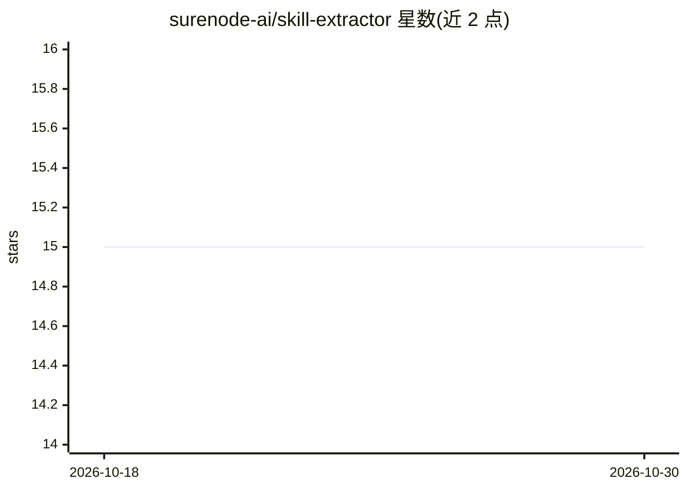

# surenode-ai/skill-extractor

⭐ 15 · Python · Apache-2.0 · 推送 2026-07-08 · [GitHub](https://github.com/surenode-ai/skill-extractor) · 组织维护

**从编码 agent 会话记录中挖掘可复用技能的本地工具**

读取 Claude Code、Codex CLI 及其他 agent 的会话转录，在本地分段并可选调用 LLM 提取候选技能，按 confidence 与 utility 打分并用会话实际结果（成功/失败）加权，经用户在 VS Code 面板或 /review-skills 命令中批准后写成 SKILL.md 文件。面向希望把重复修正转为可复用技能的个人开发者与需要评审材料的团队。默认后端为本地 claude CLI，可配置 ollama 等本地模型实现零外发；默认对密钥做模式化脱敏，安装前运行风险 lint 并需用户确认。引擎仅依赖 Python 3.9+ 标准库，macOS 提供安装脚本，其他系统可直接运行引擎。

## 筛选速览

| 维度 | 判定 | 备注 |
|---|---|---|
| AI 角色 | `ai-ecosystem` | LLM/agent 周边工具 |
| 许可风险 | `permissive` | Apache-2.0 |
| 部署形态 | `library` | 以包/库形式分发 |
| 模型依赖 | local-ok | 支持本地模型 |
| 硬件要求 | — | 无带数字的原话,不猜 |
| 安装摩擦 | `low` | 无编译、无系统依赖或容器化 |
| 成熟度 | — | 结构信号不足 |

## 能力要点

- 按会话结果（成功/失败）加权的技能候选打分与六类技能分类
- 批准/拒绝决策（含评论）反馈校准后续挖掘提示与评分先验
- 默认模式化脱敏密钥、安装前风险 lint、状态以 0600 权限 JSONL 存储
- 支持 claude_code、codex 与 jsonl_dir 适配器接入任意 agent，空闲运行零 LLM 调用

## 适用场景

- 把我在 Claude Code 里反复交代的修正沉淀为 SKILL.md 技能
- 团队共享技能目录前对挖掘出的技能做评审与风险检查
- 不依赖云端、用本地模型零外发地挖掘 agent 会话技能

## 场景标签

`Agent 记忆` · 领域:Agent 开发

## 证据(README 行号)

> L10: Mine **reusable skills** from your coding agents' transcripts. Works with
> L32: skill-extractor makes that process visible. It runs on your machine, keeps
> L104: Private traces in, model in the middle, agent instructions out. The defaults

## 星数曲线

2026-10-18 15 → 2026-10-30 15（+0）

---
*卡片 v1 · prompt 1.4 · 生成 2026-10-30 · 置信度 mid · 依据 README sha `cdef4ac5c902` · [字段定义](../../DATASET.md)*
