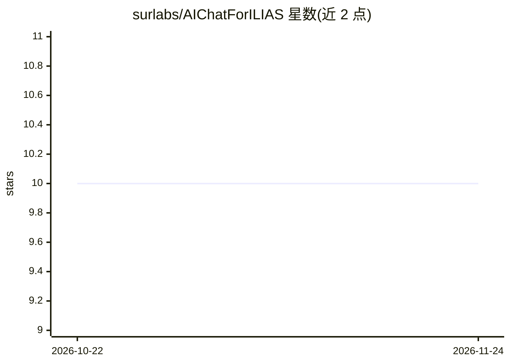

# surlabs/AIChatForILIAS

⭐ 10 · JavaScript · AGPL-3.0 · 推送 2026-06-08 · [GitHub](https://github.com/surlabs/AIChatForILIAS) · [官网](https://surlabs.com) · 组织维护

**ILIAS 平台插件：让学习平台用户直接与 LLM 对话**

由 SURLABS 维护的 ILIAS 10 开源仓库对象插件，在学习环境中提供与在线 LLM 及本地模型的实时对话，用于自动问答、内容摘要与个性化学习。支持可配置连接不同 API 端点或本地安装，可为不同聊天对象设置不同 API key，或在插件配置中统一设置全局 key。安装要求 ILIAS 10 平台、PHP 8.2，通过 git clone 到插件目录并运行 composer autoload 更新。

## 筛选速览

| 维度 | 判定 | 备注 |
|---|---|---|
| AI 角色 | `ai-native` | 本体是模型或模型工具 |
| 许可风险 | `viral` | AGPL-3.0 |
| 部署形态 | `None` |  |
| 模型依赖 | local-ok | 支持本地模型 |
| 硬件要求 | — | 无带数字的原话,不猜 |
| 安装摩擦 | `low` | 无编译、无系统依赖或容器化 |
| 成熟度 | — | 结构信号不足 |

## 能力要点

- 支持 OpenAI GPT 系列（GPT-5.4/4.1/4o 等多个型号）
- 支持本地 Ollama 运行时加载任意模型（LLaMa 3、Mistral、Gemma 等）
- 支持按聊天对象配置不同 API key 或统一全局 key

## 适用场景

- 在 ILIAS 课程中为学生提供 AI 问答与内容摘要
- 教育场景下接入本地 Ollama 模型进行学习辅助
- 平台管理员按对象分别管理 API key 配置

## 场景标签

`聊天机器人` · 领域:对话与助手

## 证据(README 行号)

> L3: # AI Chat Repository Object Plugin for ILIAS 10
> L10: This plugin enhances ILIAS platforms by enabling seamless integration with both online Large Language Models (LLMs)
> L14: This plugin currently supports the following LLMs:

## 星数曲线

2026-10-22 10 → 2026-11-24 10（+0）

---
*卡片 v1 · prompt 1.4 · 生成 2026-11-19 · 置信度 high · 依据 README sha `936c5705746a` · [字段定义](../../DATASET.md)*
