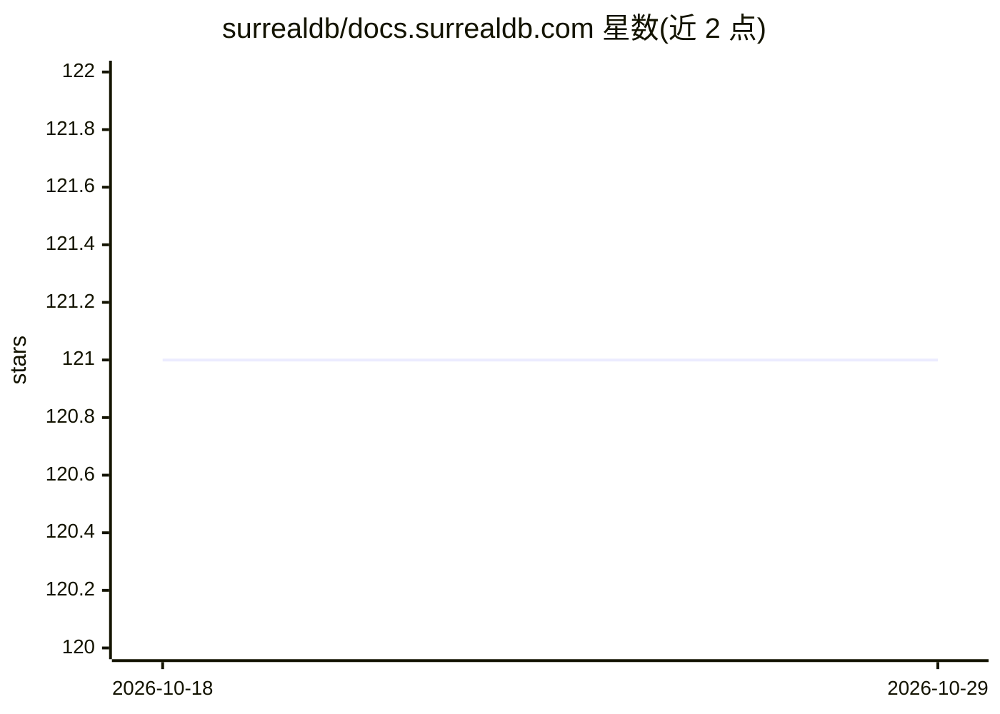

# surrealdb/docs.surrealdb.com

⭐ 121 · HTML · 推送 2026-10-28 · [GitHub](https://github.com/surrealdb/docs.surrealdb.com) · [官网](https://surrealdb.com/docs/surrealdb) · 组织维护

**SurrealDB 官方文档站源码仓库，供贡献与本地开发**

SurrealDB 数据库的官方文档网站源码，基于 Vike、React 与 Mantine 构建。内容涵盖入门指南、SurrealDB University 学习资源与社区 Lab 内容；提供 bun run make:lab 交互式工具创建 Lab 条目，支持按类别（博客/代码库/视频/文档/学习资源）与主题（AI/云/数据管理等）组织。贡献流程要求 Bun 包管理器与 Node.js v20+，本地开发用 bun dev，构建产物为静态站点。文档内容位于 src/content 目录下的 Markdown/MDX 文件。

## 筛选速览

| 维度 | 判定 | 备注 |
|---|---|---|
| AI 角色 | `ai-knowledge` | 知识聚合/清单类 |
| 许可风险 | `none` | — |
| 部署形态 | `None` |  |
| 模型依赖 | — | README 未给出锁定关系 |
| 硬件要求 | — | 无带数字的原话,不猜 |
| 安装摩擦 | `low` | 无编译、无系统依赖或容器化 |
| 成熟度 | — | 结构信号不足 |

## 能力要点

- 基于 Vike/React/Mantine 的文档站点源码
- bun run make:lab 交互式 Lab 内容创建工具
- 内容按 5 个类别与 8 个主题组织
- 渲染 SVG 铁路图（RailroadDiagram 组件）

## 适用场景

- 为 SurrealDB 文档贡献内容或修正错误
- 本地运行文档站预览改动
- 提交社区 Lab 教程与项目链接

## 场景标签

 · 领域:开发者文档/数据库

## 证据(README 行号)

> L12:  The documentation for SurrealDB, built using Vike.
> L44: Visit surrealdb.com/docs to get started with SurrealDB.

## 星数曲线

2026-10-18 121 → 2026-10-29 121（+0）

---
*卡片 v1 · prompt 1.4 · 生成 2026-10-23 · 置信度 high · 依据 README sha `c6933d0b687b` · [字段定义](../../DATASET.md)*
