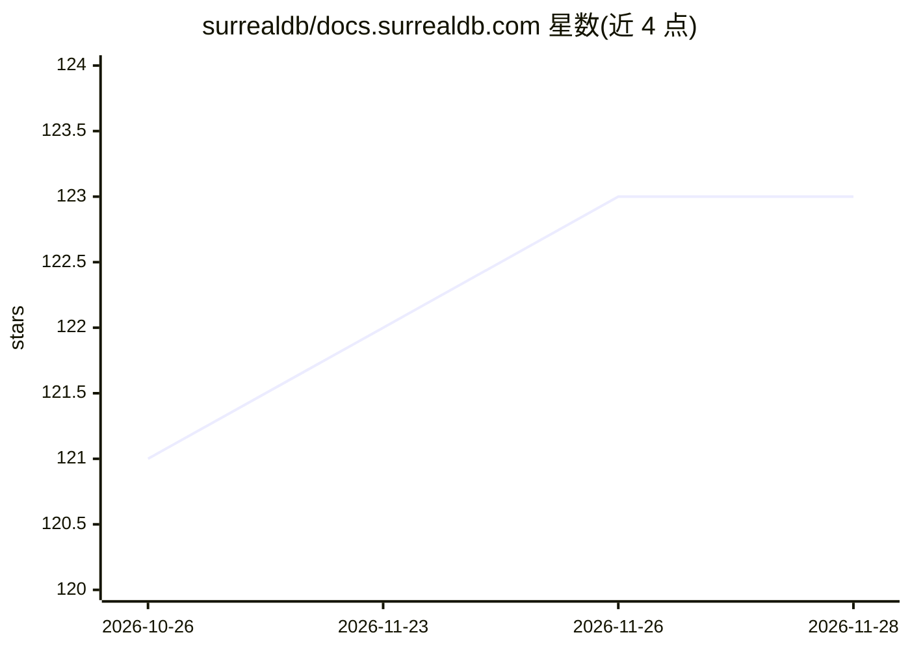

# surrealdb/docs.surrealdb.com

⭐ 123 · HTML · 推送 2026-11-27 · [GitHub](https://github.com/surrealdb/docs.surrealdb.com) · [官网](https://surrealdb.com/docs/surrealdb) · 组织维护

**SurrealDB 官方文档站的源码与贡献指南**

SurrealDB 与 SurrealDB Agent Memory 的官方文档站点源码，部署于 surrealdb.com/docs。站点以 Vike+React 构建，页面为 Markdown/MDX 文件。README 面向文档贡献者，给出 Bun/Node 环境下的本地运行步骤，并提供大量质检命令：链接检查、SurrealQL 示例测试配置、SDK 页面一致性、搜索文本抽取验证、内容陈旧度报告等，另含 llms.txt 生成与 Cloudflare/Vercel 部署命令。

## 筛选速览

| 维度 | 判定 | 备注 |
|---|---|---|
| AI 角色 | `ai-knowledge` | 知识聚合/清单类 |
| 许可风险 | `none` | — |
| 部署形态 | `None` |  |
| 模型依赖 | — | README 未给出锁定关系 |
| 硬件要求 | — | 无带数字的原话,不猜 |
| 安装摩擦 | `low` | 无编译、无系统依赖或容器化 |
| 成熟度 | — | 结构信号不足 |

## 能力要点

- 页面为 src/content 下的 Markdown/MDX，Vike+React+Mantine 构建
- 内置十余项机械性质检命令（链接、示例测试、SDK 一致性、陈旧度等）
- 可生成 public/llms.txt 供 LLM 读取文档
- 支持本地搜索 API 服务与内容索引

## 适用场景

- 为 SurrealDB 文档贡献或修订页面
- 本地预览文档站并运行质量检查
- 维护 SurrealQL 示例的测试配置

## 场景标签

 · 领域:数据库/开发者文档

## 证据(README 行号)

> L8:  The documentation for SurrealDB and SurrealDB Agent Memory, served at surrealdb.com/docs.
> L45: The site is built with Vike and React, and its pages are Markdown and MDX files in `src/content`. You need Bun 1.3 

## 星数曲线

2026-10-26 121 → 2026-11-28 123（+2）

---
*卡片 v1 · prompt 1.4 · 生成 2026-11-28 · 置信度 high · 依据 README sha `c1c050f03f56` · [字段定义](../../DATASET.md)*
