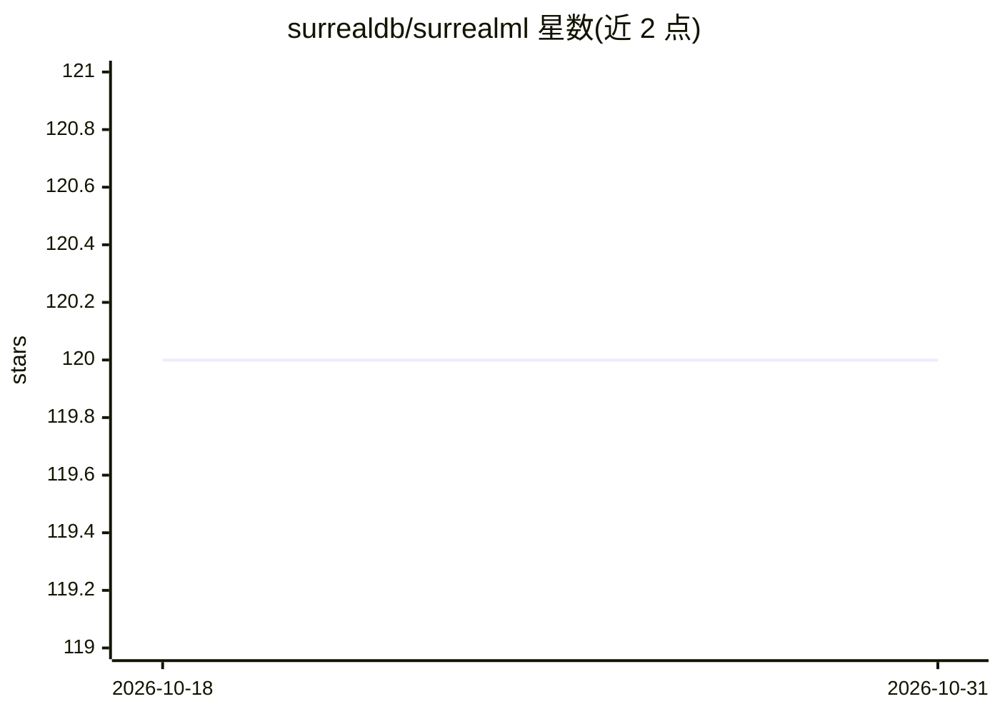

# surrealdb/surrealml

⭐ 120 · Rust · NOASSERTION · 推送 2026-02-21 · [GitHub](https://github.com/surrealdb/surrealml) · [官网](https://surrealdb.com) · 组织维护

**将训练好的 ML 模型存储并在 SurrealDB 服务端执行的库**

面向使用 SurrealDB 的 Python/Rust 开发者的机器学习模型存储与执行库：以 'surml' 格式保存 PyTorch、TensorFlow、SKLearn 训练模型及元数据，可在 Python 或 Rust 中运行，或上传到 SurrealDB 节点在服务端执行。核心为 Rust core 模块（直接编译进 SurrealDB 服务器），经 c-wrapper 产出动态 C 库供 Python、TypeScript 等客户端链接，客户端与服务端运行同一代码。前置要求包括 Python 环境、PyTorch/SKLearn 及已安装运行的 SurrealDB。

## 筛选速览

| 维度 | 判定 | 备注 |
|---|---|---|
| AI 角色 | `ai-ecosystem` | LLM/agent 周边工具 |
| 许可风险 | `none` | NOASSERTION |
| 部署形态 | `None` |  |
| 模型依赖 | — | README 未给出锁定关系 |
| 硬件要求 | — | 无带数字的原话,不猜 |
| 安装摩擦 | `low` | 无编译、无系统依赖或容器化 |
| 成熟度 | — | 结构信号不足 |

## 能力要点

- 'surml' 格式存储 PyTorch/TensorFlow/SKLearn 模型及元数据
- 模型可上传 SurrealDB 节点在服务端执行
- Rust core 编译为动态 C 库，Python/TypeScript 客户端链接同一代码

## 适用场景

- 把训练好的 ML 模型存储到数据库并在服务端推理
- 在 Python 或 Rust 客户端中加载并执行 surml 模型
- 围绕 SurrealDB 构建带模型执行能力的后端

## 场景标签

`推理引擎` · 领域:训练与推理

## 证据(README 行号)

> L3: This package is for storing machine learning models with meta data in Rust so they can be used on the SurrealDB serv
> L7: SurrealML is a feature that allows you to store trained machine learning models in a special format called 'surml'. 
> L15: We can see that the `core` module is the Rust module that houses the ML model file storage and execution of models.

## 星数曲线

2026-10-18 120 → 2026-10-31 120（+0）

---
*卡片 v1 · prompt 1.4 · 生成 2026-10-23 · 置信度 mid · 依据 README sha `9caa8e072210` · [字段定义](../../DATASET.md)*
