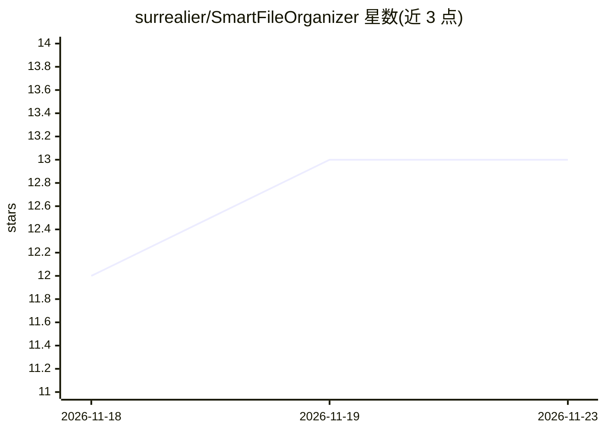

# surrealier/SmartFileOrganizer

⭐ 13 · Shell · 推送 2026-10-19 · [GitHub](https://github.com/surrealier/SmartFileOrganizer) · 个人维护

**让 AI agent 按文件内容重命名并整理文档的技能**

以 SKILL.md 形式分发的 agent 技能：递归扫描目标目录，读取 PDF、Word、Excel、PowerPoint 及韩文 HWP/HWPX 文件内容，生成基于内容的重命名方案，支持 recovery/uniform 两种严格度与 rename-only/full-organize/collect 三种模式。流程含数据集目录确认、编码回退检测（CP949、EUC-KR 等）、非允许语言自动翻译；执行前经 dry-run 逐轮确认，批准后立即保存回滚映射并支持 undo。通过 npx skills 安装，仅适用于 skills.sh 兼容的 agent。

## 筛选速览

| 维度 | 判定 | 备注 |
|---|---|---|
| AI 角色 | `ai-native` | 本体是模型或模型工具 |
| 许可风险 | `none` | — |
| 部署形态 | `library` | 以包/库形式分发 |
| 模型依赖 | — | README 未给出锁定关系 |
| 硬件要求 | — | 无带数字的原话,不猜 |
| 安装摩擦 | `low` | 无编译、无系统依赖或容器化 |
| 成熟度 | — | 结构信号不足 |

## 能力要点

- 读取文件实际内容生成重命名方案（含 .hwpx ZIP/XML 抽取）
- dry-run 审批流与回滚映射，崩溃安全、支持撤销
- recovery/uniform 严格度与三种整理模式
- 多编码回退检测与语言偏好（自动翻译非允许语言）

## 适用场景

- 清理下载文件夹里命名混乱的文档
- 批量统一项目目录中的文件命名规范
- 把符合特定用途的文件归集到一个文件夹
- 重命名后反悔时用回滚映射恢复

## 场景标签

`工作流自动化` `文档解析` · 领域:效率与自动化

## 证据(README 行号)

> L5:  AI agent skill that renames files based on what's inside them — PDF, Word, Excel, PowerPoint and Korean HWP/HWPX do
> L20: - Dry-run approval flow — iterates until user explicitly approves.
> L83: Works with skills.sh-compatible agents, including Kiro CLI, Claude Code, Cursor, Windsurf, Cline, and others.

## 星数曲线

2026-11-18 12 → 2026-11-23 13（+1）

---
*卡片 v1 · prompt 1.4 · 生成 2026-11-18 · 置信度 mid · 依据 README sha `e2a3c8830545` · [字段定义](../../DATASET.md)*
