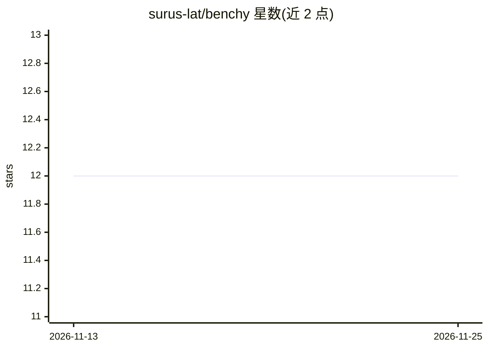

# surus-lat/benchy

⭐ 12 · Python · 推送 2026-11-19 · [GitHub](https://github.com/surus-lat/benchy) · [官网](https://benchy.lat/) · 个人维护

**为 AI 系统创建并运行任务基准的评测引擎**

以 AI-system 为原语的基准测试引擎，用 YAML 定义程序、评分函数与数据集，编译为 JSON IR 后运行，输出各字段加权得分与 valid/invalid_output/execution_error 三种状态。内置 model 适配器支持 together/bedrock/openai，凭据走环境变量，支持请求缓存续跑与 AI 评分器（rubric）任务。依赖仅 PyYAML；不支持 audio/document 输入与 transcribe 任务，任务与域限定于封闭注册表。

## 筛选速览

| 维度 | 判定 | 备注 |
|---|---|---|
| AI 角色 | `ai-ecosystem` | LLM/agent 周边工具 |
| 许可风险 | `none` | — |
| 部署形态 | `library` | 以包/库形式分发 |
| 模型依赖 | local-ok | 支持本地模型 |
| 硬件要求 | — | 无带数字的原话,不猜 |
| 安装摩擦 | `low` | 无编译、无系统依赖或容器化 |
| 成熟度 | — | 结构信号不足 |

## 能力要点

- YAML 定义基准，确定性编译为 JSON IR 运行
- 内置 together/bedrock/openai 适配器，BASE_URL 可指向 vLLM/Ollama
- 按请求键控的答案缓存，中断后可续跑
- rubric 评分器任务，支持 AI 或人工评分器绑定

## 适用场景

- 为发票抽取、分类等具体任务创建专属基准
- 同一基准评测多个 AI 系统配置
- 用 rubric 让模型对开放问答按评分标准打分

## 场景标签

`模型评测` · 领域:评测与运维

## 证据(README 行号)

> L3: A semantic language and execution engine for benchmarking AI programs.
> L84: with a while-loop) lives on your side of that line. The engine has no provider
> L137: A provider that is not taking requests — rate-limited, overloaded, down — is waited

## 星数曲线

2026-11-13 12 → 2026-11-25 12（+0）

---
*卡片 v1 · prompt 1.4 · 生成 2026-11-18 · 置信度 high · 依据 README sha `dec44a1368a7` · [字段定义](../../DATASET.md)*
